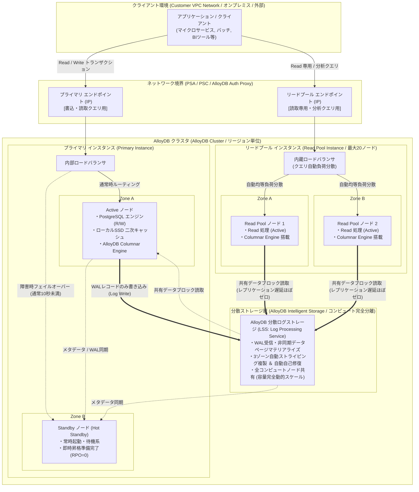

# AlloyDB for PostgreSQL アーキテクチャ構成図

Google Cloudが提供するエンタープライズ向けフルマネージドPostgreSQL互換データベース「AlloyDB for PostgreSQL」のアーキテクチャ構成図および技術仕様の解説です。

---

## 1. システム構成図 (Mermaid)

---

## 2. アーキテクチャの中核要素と動作仕様の解説

### ① プライマリ インスタンス (Primary Instance)
* **役割:** データベースへの書き込み（Read/Write）および読み取りトランザクションを一元処理します。クラスタ内に1つのみ存在します。
* **書き込み処理の高速化 (WALオフロード):**
  * 従来のPostgreSQLのように重いダーティページのディスク書き込み（チェックポイント処理）やフルページライト（`full_page_writes`）をコンピュート層で行いません。
  * コンピュートノードは**WALレコードのみをインテリジェントストレージにプッシュ**し、データブロックの合成はストレージ層のバックグラウンド処理（LSS）に任せるため、書き込みスループットが標準PostgreSQL比で最大4倍に向上します。
* **高可用性 (HA) とHot Standby:**
  * **Active ノード / Standby ノード:** 異なるゾーンに配置され、Standbyは常時稼働状態でActiveノードのWALストリームおよびストレージのメタデータを同期しています。
  * **フェイルオーバー時間:** Activeノードやゾーンに障害が発生した場合、**通常10秒未満（ダウンタイムほぼなし、RPO=0）**でStandbyノードが昇格し、内部LB経由で接続を引き継ぎます。

### ② リードプール インスタンス (Read Pool Instance)
* **役割:** 読み取り専用（Read-only）トランザクションおよび分析系クエリを水平スケールして処理します。
* **内蔵ロードバランサと単一エンドポイント:**
  * リードプールインスタンスごとに**単一のIPエンドポイント**が提供されます。
  * ノードの追加・削除（最大20ノードまで増設・オートスケール可能）を行っても接続先エンドポイントを変更する必要がなく、内蔵ロードバランサがクエリをプール内の稼働ノードに自動分散します。
* **共有ストレージによるレプリケーション遅延ゼロ:**
  * リードプールの全ノードはプライマリと同一の分散ストレージを直接参照します。データブロックのコピーが発生しないため、**ストレージ追加コストは0円**、かつレプリケーションラグ（複製遅延）はほぼゼロ（数十ミリ秒以下のメタデータ同期のみ）に抑えられます。

### ③ AlloyDB Intelligent Storage (分散ログストレージ層)
* **コンピュートとストレージの完全分離:**
  * データベースエンジン（VM）と永続ストレージが物理的に分離されたクラウドネイティブな構造です。
* **Log Processing Service (LSS):**
  * ストレージ自身がインテリジェントな分散ログ処理エンジンを備えており、コンピュートから送られたWALログからデータブロックを非同期にマテリアライズ（復元・合成）します。
* **3ゾーン自動複製と高耐久性:**
  * データはリージョン内の3ゾーンに自動的にストライピング・多重化され、1ゾーン全体の停止やディスク障害が発生しても透過的に自己修復されます。
* **完全自動動的スケーリング (Dynamic Elasticity):**
  * 事前のディスク容量プロビジョニングが不要で、データ投入量に応じて自動伸長します（最大128TiB）。

### ④ AlloyDBの差別化テクノロジー (Advanced Features)
* **AlloyDB Columnar Engine (カラム型インメモリエンジン):**
  * 行指向（Row-based）のPostgreSQLでありながら、メモリ上に透過的なインメモリ・カラム型ストアを自動構築。
  * 分析・集計クエリ（BIやOLAP処理）を**最大100倍高速化**。機械学習アルゴリズムにより、頻繁に参照されるカラムを自動選択・変換するオートカラムナー化に対応しています。
* **ローカルSSD 超高速二次キャッシュ (Ultra-fast Cache):**
  * コンピュートノードのRAM（`shared_buffers`）と共有ストレージの間に、ローカルNVMe SSDを活用した大容量キャッシュ層を配置。メモリから溢れたデータも低遅延でフェッチ可能です。
* **AlloyDB AI & ベクトル検索:**
  * `pgvector` 拡張機能に加え、Google独自の高速近似最近傍探索（ANN）技術である **ScaNN インデックス** をサポート（標準HNSWやIVFFlat比で高速・高リコール）。
  * SQL関数（`google_ml.embedding()` 等）から直接 Vertex AI の基盤モデル（テキスト/マルチモーダル埋め込み）をシームレスに呼び出し可能。
* **接続オプションの柔軟性 (PSA / PSC / Public IP):**
  * **Private Services Access (PSA):** VPCピアリングによる従来型のセキュアな閉域網接続。
  * **Private Service Connect (PSC):** IPアドレス重複を回避し、サービス単位で柔軟かつきめ細かくルーティング可能な最新接続モデル。
  * **Public IP (パブリックIP直接接続):** 承認済みネットワーク（Authorized Networks）や AlloyDB Auth Proxy と組み合わせることで、パブリックIP経由のセキュアなSSL/TLS暗号化接続にも対応。

---

## 3. Cloud SQL for PostgreSQL と AlloyDB のアーキテクチャ詳細比較

| # | アーキテクチャ要素 | Cloud SQL for PostgreSQL | AlloyDB for PostgreSQL |
| :--- | :--- | :--- | :--- |
| **1** | **基本アーキテクチャ** | **コンピュートとストレージの密結合** 各インスタンス（VM）に専用の永続ディスク（PD）が直接アタッチされる従来型設計。 | **コンピュートとストレージの完全分離** 独立した分散インテリジェントストレージを全コンピュートノードが共有するクラウドネイティブ設計。 |
| **2** | **書き込み処理メカニズム** | **標準PostgreSQL方式** ダーティページの定期フラッシュ（チェックポイント）やフルページライトが必要でI/O負荷大。 | **WALログオフロード方式 (LSS)** コンピュートはWALレコードのみをストレージへ送信。ページ合成はストレージ層で非同期処理し、極めて高スループット。 |
| **3** | **高可用性 (HA) 方式 & 切替時間** | **Regional Persistent Disk (同期複製)** 別ゾーンのディスクへストレージ同期。待機VMは障害発生時にディスクをアタッチして起動（**ダウンタイム通常約60秒**）。 | **Hot Standby (常時稼働) + 内部LB** 別ゾーンのStandbyノードが常時稼働状態でWALを受信適用済み。数秒〜**通常10秒未満で即時昇格（RPO=0）**。 |
| **4** | **リードレプリカの構成 & コスト** | **個別インスタンス ＋ 個別ストレージ** レプリカごとに専用VMとPDが必要。**レプリカを増やすごとにストレージ費用が台数分加算**。WAL非同期転送によるレプリケーション遅延が発生しうる。 | **リードプール (共有ストレージ)** 全ノードが同一ストレージを直接参照。**レプリカノードを追加してもストレージ費用は0円**。複製遅延もほぼゼロ。 |
| **5** | **負荷分散 & エンドポイント** | **レプリカ個別IP** レプリカごとに個別のIPが付与されるため、クライアント側での振り分けや外部LB（PgBouncer等）の設計が必要。 | **内蔵ロードバランサによる単一IP** リードプールごとに単一エンドポイントが提供され、最大20ノードへのクエリを内蔵LBが自動分散（オートスケール対応）。 |
| **6** | **分析クエリの高速化 (OLAP)** | **行指向エンジンのみ** 集計・集計フィルタ処理はインデックススキャンやシーケンシャルスキャンに依存。 | **AlloyDB Columnar Engine** インメモリのカラム型ストアを自動生成し、分析・BIクエリを最大100倍高速化。 |
| **7** | **AI / ベクトル検索機能** | **pgvector サポート** IVFFlat / HNSW インデックスによる標準的なベクトル検索。 | **AlloyDB AI** pgvectorに加え、Google独自の超高速 ScaNN インデックス、Vertex AIモデル呼び出し連携をサポート。 |
| **8** | **ネットワーク接続性** | **PSA / PSC / Public IP に対応** プライベート接続およびパブリックIP（承認済みネットワーク）接続をサポート。 | **PSA / PSC / Public IP に対応** 強固な閉域接続（PSA/PSC）に加え、パブリックIP + 承認済みネットワーク / Auth Proxy 接続もサポート。 |
| **9** | **ストレージ容量とスケーリング** | **事前プロビジョニング ＋ 自動拡張** 指定容量を確保して課金。一度拡張した容量の自動縮小は不可。最大64TB。 | **完全自動動的スケーリング (Dynamic)** 事前確保不要。実データ使用量に対してのみ課金。最大128TiB。 |
| **10**| **バックアップと復旧 (PITR)** | **インスタンス経由のバックアップ** バックアップ取得時にコンピュート/ディスクI/Oへの軽微な影響あり。 | **ストレージ層での継続的保護** コンピュート層に負荷をかけず、ストレージ層で継続的バックアップを実行（RPO数秒のPITR）。 |
