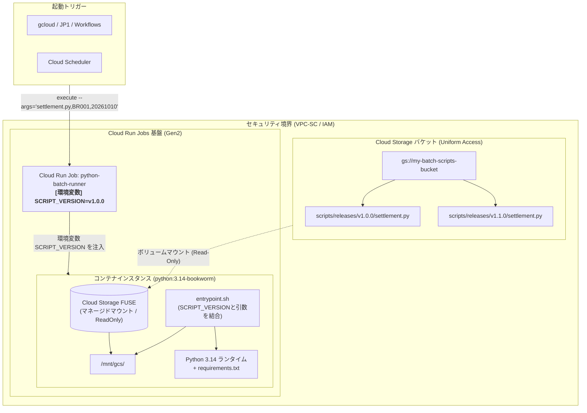
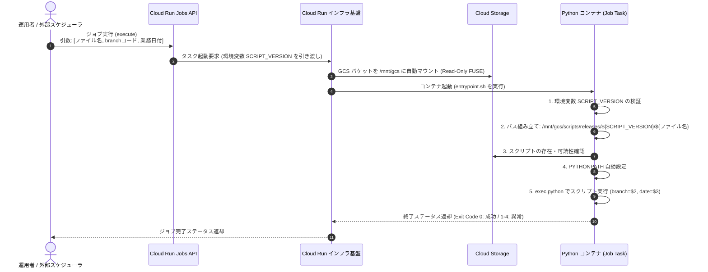

# Cloud Run Jobs Cloud Storageマウント構成・実装ガイド

Cloud Run Jobs において Cloud Storage（GCS）バケットをファイルシステムとしてボリュームマウントし、GCS 上に配置した Python スクリプトを引数および環境変数指定で動的に実行するアーキテクチャの設計・構築・運用ガイドです。

---

## 1. はじめに・結論（エグゼクティブサマリ）

### 1.1 Cloud Run Jobs への Cloud Storage マウント可否
**はい、公式にマウント可能です。**  
Cloud Run（Services および Jobs）には、Google Cloud がマネージドで提供する **Cloud Storage ボリュームマウント機能（Cloud Storage volume mounts）** が備わっています。  
ジョブの定義時にボリューム（Volume）およびボリュームマウント（Volume Mount）を指定するだけで、指定した GCS バケットをコンテナ内の任意のディレクトリパスにマウントできます。

### 1.2 Dockerfile における事前インストールの要否
**Dockerfile 側での FUSE やツールの事前インストールは「一切不要」です。**

- **理由**:  
  Cloud Run の基盤（第2世代実行環境）が、コンテナの起動処理の前にインフラストラクチャ層で Cloud Storage FUSE（gcsfuse）を自動的にセットアップし、コンテナ名前空間に対してボリュームとして透過的にマウントします。
- **メリット**:  
  - コンテナ内に `gcsfuse` や `fuse`、`libfuse2` などのパッケージを `apt-get` でインストールする必要がありません。
  - 特権コンテナ権限（`--cap-add SYS_ADMIN` や `/dev/fuse` デバイスの公開）も不要です。
  - ベースイメージである `python:3.14-bookworm` を極めて軽量かつクリーンに保つことができます。

### 1.3 バージョン管理と切り戻し（ロールバック）の結論
**スクリプトのバージョン（例: `v1.0.0`）は、Cloud Run Jobs の「環境変数（`SCRIPT_VERSION`）」として管理することを強く推奨します。**

- **効果**:
  1. **実行引数の純粋化**: 実行引数の第1引数はバージョンパスを含めず、純粋な **ファイル名（例: `settlement.py`）** のみで指定可能になります。
  2. **一元的な切り戻し**: 障害発生時、ジョブ定義の環境変数を更新（`gcloud run jobs update ... --update-env-vars="SCRIPT_VERSION=v1.0.0"`）するだけで、Cloud Scheduler や外部連携（JP1 等）の定義を変更することなく、以降の全バッチ実行を一括で旧バージョンへ切り戻せます。
  3. **アドホックな検証**: 特定の実行回のみ別のバージョンを動かしたい場合は、実行時オーバーライド（`execute --update-env-vars="SCRIPT_VERSION=v1.0.1"`）も可能です。

---

## 2. アーキテクチャ選定とトレードオフ評価

GCS 上に Python スクリプトを配置して実行する方式（本ガイドの方式）と、従来のコンテナイメージ内にコードを含める方式（イミュータブル方式）を比較します。

### 2.1 アーキテクチャ比較表

| 評価軸 | GCS マウント＋環境変数バージョン管理（本ガイド） | コンテナ内包方式（従来標準） |
| :--- | :--- | :--- |
| **コード反映速度** | ⭕ **即時反映（数秒）**<br>GCS にスクリプトを置き、環境変数を切り替えるだけ | ⚠️ **ビルド待ち（数分）**<br>コンテナビルド・プッシュ・更新が必要 |
| **切り戻し（ロールバック）** | ⭕ **極めて容易（コマンド1発・即時）**<br>`update-env-vars="SCRIPT_VERSION=v1.0.0"` のみ | ⚠️ **リビジョン・タグ差し替え**<br>Job のイメージタグ更新が必要 |
| **実行引数の可読性** | ⭕ **極めてシンプル**<br>`settlement.py,BR001,20261010`（バージョン意識不要） | ⭕ **シンプル**<br>引数は業務パラメータのみ |
| **イメージ管理・リソース共通化** | ⭕ **共通イメージ1つで多品種運用**<br>依存パッケージ共通なら何千本でも実行可能 | ❌ **ジョブ/スクリプトごとにイメージ管理**<br>またはモノリシックな巨大イメージになりがち |
| **セキュリティ・ガバナンス** | ⚠️ **厳格なGCSアクセス統制が必須**<br>GCS書き込み権限がコード実行権限に直結 | ⭕ **サプライチェーン統制が堅牢**<br>Artifact Registry と Binary Authorization で保護 |

> [!TIP]
> **推奨されるユースケース**
> - 日次バッチ処理の種類が数十〜数百本あり、頻繁にロジック調整が発生するデータ集計基盤
> - コンテナビルドパイプラインを毎回回すオーバーヘッドを削減したい開発・運用環境
> - 障害発生時に「即座に前バージョンのスクリプトへ一括切り戻し」することが最優先される運用体制

---

## 3. 全体アーキテクチャ・処理フロー

### 3.1 アーキテクチャ構成図



### 3.2 実行シーケンス



---

## 4. コンテナイメージの設計と実装

### 4.1 ディレクトリ構成

コンテナビルド用のローカル資材は以下の最小構成とします。

```text
batch-runner/
├── Dockerfile
├── entrypoint.sh
└── requirements.txt
```

### 4.2 Dockerfile（`python:3.14-bookworm` ベース）

前述の通り、FUSE 関連パッケージのインストールは不要です。標準的な Python 環境構築と、エントリポイントスクリプトの配置のみを行います。

```dockerfile
# ベースイメージ: 公式の Python 3.14 Bookworm を使用
# （※ 本番利用において特定C拡張ライブラリ等の安定性を重視する場合は 3.12 / 3.13-bookworm も選択肢）
FROM python:3.14-bookworm

# 標準出力・エラー出力のバッファリングを無効化（ログをリアルタイムに Cloud Logging へ送信）
ENV PYTHONUNBUFFERED=1 \
    PYTHONDONTWRITEBYTECODE=1 \
    TZ=Asia/Tokyo

# デフォルトのスクリプトバージョン（ジョブ定義の環境変数で上書きされる）
ENV SCRIPT_VERSION="v1.0.0"

# 作業ディレクトリの設定
WORKDIR /app

# 依存パッケージ定義のコピー
COPY requirements.txt .

# 依存パッケージのインストール
# ※ 新しいサードパーティ製ライブラリが必要になった場合のみ、requirements.txt を更新してイメージを再ビルド
RUN pip install --no-cache-dir -r requirements.txt

# エントリポイントスクリプトの配置と実行権限付与
COPY entrypoint.sh /app/entrypoint.sh
RUN chmod +x /app/entrypoint.sh

# マウントポイント用ディレクトリの作成
RUN mkdir -p /mnt/gcs

# コンテナ起動時に entrypoint.sh を実行
ENTRYPOINT ["/app/entrypoint.sh"]
```

### 4.3 エントリポイントスクリプト（`entrypoint.sh`）

環境変数 `SCRIPT_VERSION` を読み取り、渡されたスクリプトファイル名と結合して安全に実行するシェルスクリプトです。

```bash
#!/usr/bin/env bash
set -euo pipefail

# ==========================================
# Cloud Run Jobs エントリポイント
# 環境変数:
#   SCRIPT_VERSION: スクリプトのバージョン（例: v1.0.0）
# 引数仕様:
#   $1: Pythonスクリプトファイル名（例: settlement.py）
#   $2: branchコード
#   $3: 業務日付 (yyyymmdd)
#   $@: 追加のオプショナル引数
# ==========================================

# 1. 引数の個数チェック
if [ "$#" -lt 3 ]; then
  echo "[ERROR] 引数が不足しています。" >&2
  echo "使用法: $0 <script_filename> <branch_code> <biz_date(yyyymmdd)> [追加オプション...]" >&2
  exit 1
fi

SCRIPT_PARAM="$1"
BRANCH_CODE="$2"
BIZ_DATE="$3"
shift 3  # 残りの引数を退避

# 2. 環境変数 SCRIPT_VERSION のチェック
if [ -z "${SCRIPT_VERSION:-}" ]; then
  echo "[FATAL] 環境変数 SCRIPT_VERSION が設定されていません。" >&2
  echo "[FATAL] Cloud Run Jobs の環境変数設定を確認してください。" >&2
  exit 2
fi

# マウントベースディレクトリ
MOUNT_BASE_DIR="/mnt/gcs"

# 3. 実行対象スクリプトの絶対パスを解決
# もし第1引数がすでに 'scripts/' や '/' から始まるパスの場合はそのまま利用し、
# 単一のファイル名（例: settlement.py）の場合はバージョンディレクトリを付与する
if [[ "${SCRIPT_PARAM}" == *"/"* ]]; then
  TARGET_SCRIPT="${MOUNT_BASE_DIR}/${SCRIPT_PARAM}"
else
  TARGET_SCRIPT="${MOUNT_BASE_DIR}/scripts/releases/${SCRIPT_VERSION}/${SCRIPT_PARAM}"
fi

echo "=========================================="
echo "[INFO] Cloud Run Jobs タスク起動"
echo "[INFO] バージョン (ENV) : ${SCRIPT_VERSION}"
echo "[INFO] 実行スクリプト   : ${TARGET_SCRIPT}"
echo "[INFO] Branch コード     : ${BRANCH_CODE}"
echo "[INFO] 業務日付          : ${BIZ_DATE}"
echo "=========================================="

# 4. GCSマウントの確認
if [ ! -d "${MOUNT_BASE_DIR}" ]; then
  echo "[FATAL] マウントディレクトリ (${MOUNT_BASE_DIR}) が存在しません。" >&2
  echo "[FATAL] Cloud Run Jobs のボリューム設定を確認してください。" >&2
  exit 3
fi

# 5. 指定されたPythonスクリプトの存在確認
if [ ! -f "${TARGET_SCRIPT}" ]; then
  echo "[FATAL] 指定されたスクリプトが見つかりません: ${TARGET_SCRIPT}" >&2
  echo "[FATAL] GCSバケットの scripts/releases/${SCRIPT_VERSION}/ 配下にファイルが存在するか確認してください。" >&2
  exit 4
fi

# 6. 業務日付のフォーマットチェック (8桁の数字 yyyymmdd)
if ! [[ "${BIZ_DATE}" =~ ^[0-9]{8}$ ]]; then
  echo "[ERROR] 業務日付は yyyymmdd 形式の8桁の数字で指定してください (入力値: ${BIZ_DATE})" >&2
  exit 5
fi

# 7. PYTHONPATH の自動解決
# 該当バージョンのディレクトリを PYTHONPATH に追加し、同一ディレクトリ内のモジュール import を可能にする
SCRIPT_DIR="$(dirname "${TARGET_SCRIPT}")"
export PYTHONPATH="${SCRIPT_DIR}:${PYTHONPATH:-}"

# 8. スクリプトの実行（exec により PID 1 を Python に置換し、SIGTERM を直通させる）
echo "[INFO] Python スクリプトを実行します..."
exec python "${TARGET_SCRIPT}" --branch "${BRANCH_CODE}" --biz-date "${BIZ_DATE}" "$@"
```

### 4.4 依存パッケージ管理（`requirements.txt`）

```text
# Google Cloud クライアントライブラリ
google-cloud-storage>=2.18.0
google-cloud-bigquery>=3.25.0
google-cloud-logging>=3.11.0

# 業務データ処理ライブラリ
pandas>=2.2.0
numpy>=2.0.0

# ユーティリティ
python-dateutil>=2.9.0
```

---

## 5. Cloud Storage のスクリプト配置と切り戻し（ロールバック）設計

### 5.1 GCS バケット構成

バージョン単位（Semantic Versioning）のディレクトリ構造を採用します。

```text
gs://my-batch-scripts-bucket/
└── scripts/
    └── releases/
        ├── v1.0.0/
        │   ├── settlement.py          <-- 安定版（旧バージョン）
        │   └── common_calc.py
        └── v1.1.0/
            ├── settlement.py          <-- 新バージョン（障害発生）
            └── common_calc.py
```

---

### 5.2 環境変数（`SCRIPT_VERSION`）による管理と切り戻し手順

スクリプトのバージョンを Cloud Run Jobs の環境変数として一元管理することで、運用の柔軟性と安全性が飛躍的に向上します。

```
【通常運用時 (v1.1.0)】
Cloud Run Job [SCRIPT_VERSION=v1.1.0]
    │
    ├─► Scheduler 実行 (--args="settlement.py,BR001,20261010")  ──► v1.1.0 を参照 (障害発生!)
    └─► 手動/JP1 実行 (--args="settlement.py,BR002,20261010")  ──► v1.1.0 を参照

【切り戻し時 (update-env-vars=SCRIPT_VERSION=v1.0.0 を実行)】
Cloud Run Job [SCRIPT_VERSION=v1.0.0 に更新]  ※スケジューラ側の変更は一切不要！
    │
    ├─► Scheduler 実行 (--args="settlement.py,BR001,20261010")  ──► v1.0.0 を参照 (復旧完了)
    └─► 手動/JP1 実行 (--args="settlement.py,BR002,20261010")  ──► v1.0.0 を参照 (復旧完了)
```

#### パターン1: 【推奨】ジョブ定義の環境変数更新による一括切り戻し（恒久対応）
新バージョン（`v1.1.0`）にバグが発覚した場合、以下のコマンドを実行するだけで、**以降のすべてのバッチ実行（Cloud Scheduler、手動実行、JP1連携等）が一括して旧バージョン（`v1.0.0`）を参照**するようになります。

```bash
# ジョブ定義の環境変数を旧バージョン (v1.0.0) に更新（数秒で完了）
gcloud run jobs update python-batch-runner \
  --region=asia-northeast1 \
  --update-env-vars="SCRIPT_VERSION=v1.0.0"
```

- **メリット**:
  - **スケジューラや外部連携の定義変更が一切不要**: 実行側は常に `settlement.py` とだけ指定しているため、呼び出し元の設定を変更する必要がありません。
  - **人的ミスの排除**: 複数あるスケジュールジョブの引数を1つずつ修正して回る手間や修正漏れが発生しません。

#### パターン2: 実行コマンドでの環境変数オーバーライド（特定実行のみの臨時切り戻し/検証）
ジョブ定義全体の環境変数は変更せず、特定の実行回のみ旧バージョンで再実行したい場合、または特定店舗のみ新バージョンを先行テストしたい場合は、実行コマンドで環境変数を一時上書きできます。

```bash
# この実行回のみ一時的に v1.0.0 で実行する
gcloud run jobs execute python-batch-runner \
  --region=asia-northeast1 \
  --update-env-vars="SCRIPT_VERSION=v1.0.0" \
  --args="settlement.py,BR-TOKYO-01,20261010"
```

---

### 5.3 切り戻し方式の比較まとめ

| 比較項目 | ① 環境変数更新方式（★最推奨） | ② 実行引数変更方式 | ③ GCSファイル上書き方式 |
| :--- | :--- | :--- | :--- |
| **管理場所** | **Cloud Run ジョブ定義（環境変数）** | 起動側（Scheduler/JP1引数） | GCS バケット内 |
| **切り戻しコマンド** | `jobs update --update-env-vars` | `jobs execute --args` | `gcloud storage cp`（世代復元） |
| **切り戻し所要時間** | **数秒（コマンド1発）** | 引数修正＋再実行 | 1〜2分（世代特定＋コピー） |
| **呼び出し元への影響** | **影響なし**（ファイル名固定） | あり（全スケジューラの引数修正） | 影響なし |
| **FUSE キャッシュ影響** | **なし**（別パス即時参照） | なし（別パス即時参照） | あり（メタデータキャッシュ待機） |
| **総合評価** | ★★★ **最も安全・運用負荷最小** | ★★☆（引数の肥大化・変更漏れ懸念） | ★☆☆（キャッシュリスクあり） |

---

## 6. セキュリティとガバナンス設計

動的スクリプト実行構成において最も警戒すべきリスクは、**「GCS バケットへの書き込み権限を持つユーザーが悪意あるコードや不具合コードを混入させるサプライチェーンリスク」** です。

### 6.1 均一なバケットレベルのアクセス（UBLA）の強制
ACL による個別権限管理を廃止し、プロジェクトの IAM で一元管理します。

```bash
gcloud storage buckets update gs://my-batch-scripts-bucket --uniform-bucket-level-access
```

### 6.2 権限の分離（最小権限の原則）

| アカウント種別 | 付与する IAM ロール | 目的 |
| :--- | :--- | :--- |
| **Cloud Run 実行サービスアカウント** (`sa-batch-runner`) | `roles/storage.objectViewer` | GCS からの読み取り専用マウント |
| **CI/CD デプロイサービスアカウント** (`sa-batch-deployer`) | `roles/storage.objectAdmin` | Git リポジトリからのスクリプト自動同期 |
| **一般開発者・運用者** | 閲覧権限のみ（直接の GCS 変更は禁止） | コードレビューを経ない本番コード混入の防止 |

```bash
# Cloud Run 実行用サービスアカウントへの読み取り専用権限付与
gcloud storage buckets add-iam-policy-binding gs://my-batch-scripts-bucket \
  --member="serviceAccount:sa-batch-runner@YOUR_PROJECT_ID.iam.gserviceaccount.com" \
  --role="roles/storage.objectViewer"
```

---

## 7. Cloud Run Jobs の作成とボリュームマウント設定

### 7.1 コンテナイメージのビルドとプッシュ

```bash
IMAGE_URI="asia-northeast1-docker.pkg.dev/YOUR_PROJECT_ID/batch-repo/python-batch-runner:v1.0.0"

docker build -t "${IMAGE_URI}" .
docker push "${IMAGE_URI}"
```

### 7.2 ジョブの作成コマンド（環境変数 SCRIPT_VERSION の初期設定）

```bash
gcloud run jobs create python-batch-runner \
  --project="YOUR_PROJECT_ID" \
  --region="asia-northeast1" \
  --image="${IMAGE_URI}" \
  --service-account="sa-batch-runner@YOUR_PROJECT_ID.iam.gserviceaccount.com" \
  --cpu="1" \
  --memory="2Gi" \
  --max-retries=0 \
  --task-timeout="1800s" \
  --execution-environment="gen2" \
  --set-env-vars="SCRIPT_VERSION=v1.0.0" \
  --add-volume="name=gcs-scripts-vol,type=cloud-storage,bucket=my-batch-scripts-bucket,readonly=true" \
  --add-volume-mount="volume=gcs-scripts-vol,mount-path=/mnt/gcs"
```

#### 設定パラメータのポイント
- `--set-env-vars="SCRIPT_VERSION=v1.0.0"`:  
  初期バージョンとして `v1.0.0` を登録します。
- `--memory="2Gi"`:  
  Cloud Storage FUSE プロセスのメモリ消費（約50〜100MB＋バッファ）を吸収するため、2GiB を割り当てます。
- `--add-volume=...,readonly=true`:  
  マウントを読み取り専用とし、コンテナ側からのスクリプト改変事故を防止します。

---

## 8. ジョブの実行と引数仕様の実装

### 8.1 引数仕様

環境変数でバージョンを管理するため、実行引数は純粋な業務パラメータのみになります。

| 引数位置 | 項目名 | 例 | 説明 |
| :---: | :--- | :--- | :--- |
| **第1引数** | スクリプトファイル名 | `settlement.py` | 実行対象のファイル名（単体ファイル名） |
| **第2引数** | branchコード | `BR-TOKYO-01` | 処理対象の店舗・支社コード |
| **第3引数** | 業務日付 | `20261010` | 処理基準となる日付（yyyymmdd 形式） |

### 8.2 Python スクリプトの実装例（Cloud Logging 構造化ログ対応）

GCS に配置する Python スクリプトは、引数をパースするとともに、Cloud Logging に適合したログ出力を行います。

```python
#!/usr/bin/env python3
"""
GCS上に配置する業務バッチスクリプト例
配置先: gs://my-batch-scripts-bucket/scripts/releases/v1.0.0/settlement.py
"""
import sys
import json
import logging
import argparse
from datetime import datetime

# Cloud Logging に対応した構造化ログ出力設定
class JsonFormatter(logging.Formatter):
    def format(self, record):
        log_record = {
            "severity": record.levelname,
            "message": record.getMessage(),
            "logger": record.name,
            "time": datetime.utcnow().isoformat() + "Z"
        }
        if record.exc_info:
            log_record["exception"] = self.formatException(record.exc_info)
        return json.dumps(log_record, ensure_ascii=False)

handler = logging.StreamHandler(sys.stdout)
handler.setFormatter(JsonFormatter())
logger = logging.getLogger("batch_settlement")
logger.setLevel(logging.INFO)

def parse_args():
    parser = argparse.ArgumentParser(description="日次決算・集計バッチ処理")
    parser.add_argument("--branch", required=True, help="対象branchコード (例: BR-TOKYO-01)")
    parser.add_argument("--biz-date", required=True, help="業務日付 yyyymmdd (例: 20261010)")
    return parser.parse_args()

def validate_date(date_str: str) -> datetime:
    try:
        return datetime.strptime(date_str, "%Y%m%d")
    except ValueError:
        raise ValueError(f"業務日付の形式が不正です: {date_str} (想定形式: YYYYMMDD)")

def main():
    args = parse_args()
    logger.info(f"バッチ処理を開始します (Python: {sys.version.split()[0]})")
    logger.info(f"パラメータ: branch={args.branch}, biz_date={args.biz_date}")

    try:
        target_date = validate_date(args.biz_date)
        logger.info(f"処理対象日（検証済）: {target_date.strftime('%Y-%m-%d')}")

        # ----------------------------------------------------
        # ここに業務ロジックを実装（BigQuery 実行、集計処理等）
        # ----------------------------------------------------
        logger.info(f"Branch [{args.branch}] の集計データを処理中...")

        logger.info("日次バッチ処理が正常に完了しました。")
        sys.exit(0)

    except Exception as e:
        logger.error(f"バッチ処理中に予期せぬエラーが発生しました: {e}", exc_info=True)
        sys.exit(1)

if __name__ == "__main__":
    main()
```

### 8.3 ジョブの実行コマンド（手動・スケジューラ）

#### CLI による手動実行（ファイル名のみ指定）
```bash
gcloud run jobs execute python-batch-runner \
  --region="asia-northeast1" \
  --args="settlement.py,BR-TOKYO-01,20261010"
```

#### Cloud Scheduler による定期実行（API Direct Call）
```bash
gcloud scheduler jobs create http daily-settlement-scheduler \
  --location="asia-northeast1" \
  --schedule="0 2 * * *" \
  --time-zone="Asia/Tokyo" \
  --uri="https://asia-northeast1-run.googleapis.com/v2/projects/YOUR_PROJECT_ID/locations/asia-northeast1/jobs/python-batch-runner:run" \
  --http-method=POST \
  --oauth-service-account-email="sa-batch-runner@YOUR_PROJECT_ID.iam.gserviceaccount.com" \
  --message-body='{
    "overrides": {
      "containerOverrides": [
        {
          "args": ["settlement.py", "BR-TOKYO-01", "20261010"]
        }
      ]
    }
  }'
```

---

## 9. CI/CD 自動化パイプライン設計（Cloud Build 例）

Git タグプッシュを検知して GCS へのスクリプトアップロードを行い、必要に応じて Cloud Run Jobs の環境変数 `SCRIPT_VERSION` を自動更新する Cloud Build の設定例です。

```yaml
# cloudbuild.yaml
steps:
  # 1. Python コードの静的解析・構文チェック
  - name: 'python:3.14-bookworm'
    entrypoint: 'bash'
    args:
      - '-c'
      - |
        pip install flake8
        flake8 scripts/

  # 2. GCS バケットへのバージョン別アップロード
  - name: 'gcr.io/google.com/cloudsdktool/cloud-sdk'
    entrypoint: 'bash'
    args:
      - '-c'
      - |
        VERSION="$TAG_NAME"
        echo "Release Version: $VERSION"
        gcloud storage rsync scripts/ gs://my-batch-scripts-bucket/scripts/releases/$VERSION/ --recursive

  # 3. Cloud Run Jobs の環境変数を新バージョンへ自動更新（自動デプロイ運用の場合）
  - name: 'gcr.io/google.com/cloudsdktool/cloud-sdk'
    entrypoint: 'bash'
    args:
      - '-c'
      - |
        VERSION="$TAG_NAME"
        gcloud run jobs update python-batch-runner \
          --region=asia-northeast1 \
          --update-env-vars="SCRIPT_VERSION=$VERSION"
```

---

## 10. 運用上の注意点・落とし穴（FUSE 特有の挙動）

1. **暗黙的ディレクトリ（Implicit Directories）の挙動**:
   - GCS はフラットな名前空間であるため、コンソール画面や一部ツールからアップロードした場合、中間の「ディレクトリオブジェクト」が作成されないことがあります。
   - `gcloud storage rsync` または `gcloud storage cp` を使用することで、安全なディレクトリ階層構造を維持できます。
2. **実行権限（Permission）の扱い**:
   - GCS のファイルには Linux のパーミッションビット（`chmod +x`）が永続化されません。
   - そのため、スクリプトを `./script.py` と直接実行するのではなく、**必ず `entrypoint.sh` 内で `exec python "${TARGET_SCRIPT}"` と明示的に Python インタプリタに渡して実行** してください。
3. **ローカル開発・テストの容易性**:
   - 開発時は GCS にアップロードせずとも、Docker のローカルバインドマウント（`-v $(pwd)/scripts:/mnt/gcs/scripts:ro`）と環境変数（`-e SCRIPT_VERSION=v1.0.0`）を使用することで、本番と全く同一のコンテナ＆`entrypoint.sh` でローカル動作検証が可能です。

---

## 11. まとめ・運用チェックリスト

| 分野 | チェック項目 | 判定 |
| :--- | :--- | :---: |
| **環境変数設計** | スクリプトバージョンを環境変数 `SCRIPT_VERSION` で一元管理しているか | [ ] |
| **切り戻し運用** | `gcloud run jobs update --update-env-vars="SCRIPT_VERSION=..."` で一括ロールバックする手順が定義されているか | [ ] |
| **Dockerfile** | FUSE や gcsfuse などの余計なパッケージをインストールしていないか | [ ] |
| **Dockerfile** | `entrypoint.sh` で `exec python` によるシグナル転送を行っているか | [ ] |
| **GCS 設計** | バージョン別ディレクトリ方式（`releases/vX.Y.Z/`）を採用しているか | [ ] |
| **GCS 設計** | 均一なバケットレベルのアクセス（UBLA）が有効になっているか | [ ] |
| **セキュリティ** | ジョブ実行サービスアカウントは `roles/storage.objectViewer`（読み取り専用）に限定されているか | [ ] |
| **Cloud Run** | `--execution-environment="gen2"` が設定されているか | [ ] |
| **Cloud Run** | ボリュームマウントに `readonly=true` を指定しているか | [ ] |
| **Cloud Run** | メモリサイズは FUSE オーバーヘッドを考慮し 1GiB〜2GiB 以上確保しているか | [ ] |
| **実行引数** | 実行引数は純粋な「ファイル名」「branchコード」「業務日付」となっているか | [ ] |
