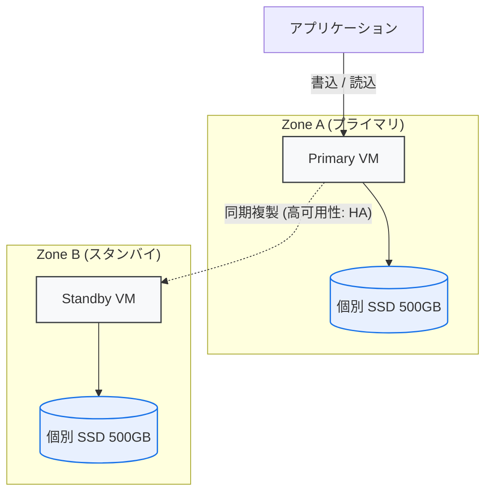
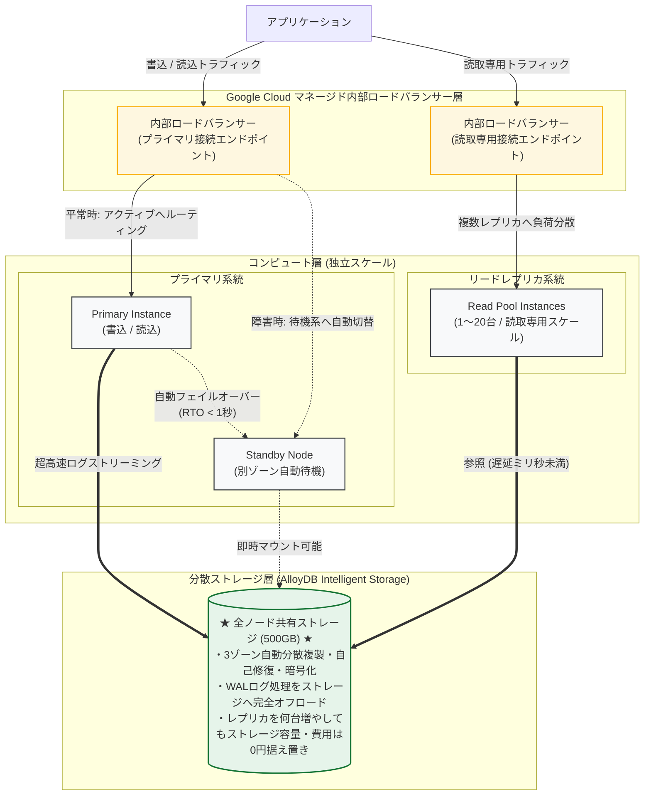
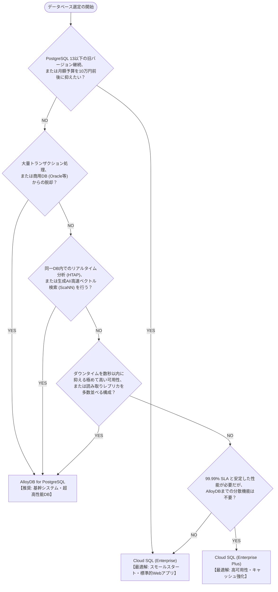

# Cloud SQL for PostgreSQL vs AlloyDB for PostgreSQL 詳細比較

Google Cloudが提供する2つのPostgreSQLマネージドサービス、「Cloud SQL」と「AlloyDB」の違いを、アーキテクチャ図、詳細比較マトリクス、ディープダイブ解説、具体的な概算費用例、および選定フローチャートを交えて徹底解説します。

---

## 1. アーキテクチャの視覚的比較

### ■ Cloud SQL for PostgreSQL (伝統的な直結型アーキテクチャ)
従来のデータベースと同様に、仮想マシン（コンピュート）と永続ディスク（Persistent Disk）が1対1で紐づく構造です。

*   **特徴:** 
    *   **ストレージの重複:** リードレプリカを追加するたびに、ストレージ容量もその分だけ重複してプロビジョニングされ、ストレージ費用とわずかな複製遅延（Replication Lag）が発生します。
    *   **フェイルオーバーの仕組み:** フェイルオーバー時にはスタンバイノードへの切り替え後にデータベースプロセスのクラッシュリカバリ（WAL再適用）が走るため、復旧に数十秒〜1分程度（Enterpriseの場合）を要します。

### ■ AlloyDB for PostgreSQL (次世代の分離・分散共有ストレージ型)
Google独自の超高速Borgネットワークインフラを介し、コンピュート層とストレージ層を完全に分離した構造です。

*   **特徴:** 
    *   **内部ロードバランサー（ILB）による透過的ルーティング:** アプリケーションとインスタンスの間にGoogle Cloudのマネージド内部LBが配置され、単一の接続エンドポイント（プライマリ用／読取用）が提供されます。プライマリ障害時も接続先IPを変更することなく透過的に待機系へ切り替わり、リードプール宛てのトラフィックは複数レプリカへ自動負荷分散されます。
    *   **ストレージの共有:** 読み取り専用レプリカ（Read Pool）を何台追加してもストレージ料金は**0円（容量追加なし）**。レプリケーション遅延もミリ秒未満です。
    *   **WAL処理のオフロード:** コンピュート側はログレコード（WAL）をストレージに送るだけで、データブロックの更新・マージはストレージ側の分散ノードがバックグラウンドで行います。
    *   **ほぼ無瞬断のフェイルオーバー (RTO < 1秒):** ストレージ側で常にデータブロックが最新化されているため、コンピュート障害時に長時間のログ再生が不要で、瞬時に別ノードへフェイルオーバー可能です。

---

## 2. 詳細比較マトリクス

Google CloudのPostgreSQLソリューションは、主に **「Cloud SQL Enterprise」**、**「Cloud SQL Enterprise Plus」**、**「AlloyDB for PostgreSQL」** の3つの階層に分類されます。

| 比較軸 | Cloud SQL (Enterprise) | Cloud SQL (Enterprise Plus) | AlloyDB for PostgreSQL |
| :--- | :--- | :--- | :--- |
| **基本コンセプト** | 標準的なPostgreSQLをシンプルにマネージド化 | Cloud SQLの性能・SLAを向上させたハイエンド層 | PostgreSQL完全互換の、Google独自次世代分散DB |
| **アーキテクチャ** | コンピュート＋ディスク**密結合** | コンピュート＋ディスク**密結合**（SSDデータキャッシュ付） | コンピュートとストレージの**完全分離・共有型** |
| **主な用途** | 一般的なWebアプリ、中小〜中規模OLTP | 高スループットが求められる基幹OLTP | 大規模・高負荷OLTP、**HTAP（分析統合）**、AI基盤 |
| **トランザクション性能** | 標準的（OSS PostgreSQLと同等） | 標準PostgreSQL比 **最大1.5〜2倍** | 標準PostgreSQL比 **最大4倍** |
| **分析処理 (OLAP/HTAP)** | 苦手（行走査、重い集計は負荷大） | 苦手（行指向のみ） | **極めて強力（インテリジェント・カラムナエンジン内包）** |
| **生成AI / ベクター検索** | pgvector 拡張機能 | pgvector 拡張機能 | **AlloyDB AI（ScaNN索引、Vertex AI連携、最大10倍高速）** |
| **レプリカのストレージ費** | レプリカごとに**同容量の料金が加算** | レプリカごとに**同容量の料金が加算** | 共有ストレージのため**何台増やしてもストレージ費0円** |
| **可用性 (SLA)** | 99.95% | 99.99% | **99.99%（全構成で業界最高水準）** |
| **フェイルオーバー (RTO)** | 約60秒以内 | 10秒以内（計画保守はほぼ無停止） | **1秒未満〜数秒以内（データロスなし、ログ再生不要）** |
| **ネットワーク接続性** | パブリックIP / プライベート(PSA/PSC) | パブリックIP / プライベート(PSA/PSC) | **パブリックIP / プライベート(PSC推奨 / PSA)** 対応 |
| **ストレージ自動拡張** | **可能**（手動縮小は制約あり） | **可能**（手動縮小は制約あり） | **完全自動スケール（事前指定不要、実使用量のみ課金）** |
| **ストレージ最大容量** | **最大 64 TB**（共有コアは 3 TB） | **最大 64 TB** | **最大 128 TiB**（デフォルト 16 TiB、クォータ申請可） |
| **インスタンス停止・起動** | **可能**（ただし**レプリカ存在時は不可**） | **可能**（ただし**レプリカ存在時は不可**） | **可能（プライマリ／読取プールを個別に制御自由）** |
| **対応バージョン** | **PostgreSQL 9.6 〜 18**（デフォルト: 18） | **PostgreSQL 14 〜 18** | **PostgreSQL 14 〜 18**（最新版への追従が最速） |
| **延長サポート (EOL対応)** | **あり（有償）**：9.6〜13を継続可能 | **あり（有償）**：旧バージョン対応 | **なし**（モダンバージョン14以降に特化） |
| **バックアップ設定粒度** | 日次（1日1回固定）、4時間幅、PITR 1〜7日 | 日次（1日1回固定）、4時間幅、PITR 1〜7日 | **曜日指定可、1日複数回可、5分幅、PITR 1〜35日** |
| **メンテナンス設定** | 曜日＋1時間枠、**拒否最長90日**、更新順序指定可 | 曜日＋1時間枠、**拒否最長90日**、更新順序指定可 | 曜日＋1時間枠、拒否1〜30日 |
| **ハイブリッド / ローカル** | 不可（Google Cloud上のみ） | 不可（Google Cloud上のみ） | **AlloyDB Omni（オンプレミス・Docker環境で実行可能）** |
| **コスト水準 (月額目安)** | **最も安価**（スモールスタート最適） | **中程度**（AlloyDBに近いが若干低廉） | **高め**（ただし大規模・レプリカ多数で逆転） |

---

## 3. ディープダイブ：プロが着目する設計・運用の決定的な違い

### ① カラムナエンジンによる「HTAP」の実現
AlloyDBには、メモリ内にデータを列指向（カラムナフォーマット）で自動生成・保持する**インテリジェント・カラムナエンジン**が標準搭載されています。
*   **Cloud SQL:** 行指向（Row-based）のみ。売上集計や特定列の集計などを行う場合、すべての行データを走査する必要があり、ディスクI/OとCPUを激しく消費します。
*   **AlloyDB:** 
    *   更新・挿入といったトランザクション（OLTP）は「行指向」で高速にコミット。
    *   集計・分析クエリ（OLAP）が発行されると、機械学習オプティマイザが判断し、自動構築された「列指向メモリキャッシュ」を利用して最大100倍高速に処理します。
    *   **効果:** 従来はBigQueryなどへETLバッチ連携しなければ耐えられなかったリアルタイムBIや大規模ダッシュボードを、本番DB上でトランザクションを阻害せずに直接実行（HTAP）できます。

### ② WALオフロードと「RTO 1秒未満」の超高速フェイルオーバー
可用性（HA）における最大のアーキテクチャ差は「障害発生時の復旧メカニズム」にあります。
*   **Cloud SQL:** プライマリVMがダウンした場合、スタンバイVMへトラフィックを切り替えますが、PostgreSQLエンジンが起動して直近のWALログをディスクから読み込み、整合性を整える「クラッシュリカバリ処理」が必要です。そのため、Enterpriseでは約60秒、Plusでも数秒〜10秒程度のダウンタイム（RTO）が発生します。
*   **AlloyDB:** WALの適用・マージはコンピュートではなく**インテリジェント・ストレージ層が自律的に実行**しています。そのため、プライマリがダウンしても、待機系コンピュートはすでに完全に最新化された共有ストレージを即座にマウントするだけでよく、**データ損失ゼロ（RPO=0）かつ1秒未満〜数秒以内（RTO < 1秒）**でフェイルオーバーが完了します。

### ③ 生成AI・ベクター検索の真価：AlloyDB AI vs Cloud SQL (pgvector)
生成AIアプリケーション（RAG: 検索拡張生成）におけるベクトルデータベースとしての性能にも決定的な差があります。
*   **Cloud SQL:** オープンソースの `pgvector` 拡張機能（HNSW, IVFFlat）をサポート。標準的な規模のベクター検索には十分対応可能です。
*   **AlloyDB:** 生成AIに特化した **AlloyDB AI** スイートを標準提供しています。
    *   **Google ScaNNインデックス:** Google検索やYouTubeの推薦基盤で培われた近傍探索アルゴリズム「ScaNN」を統合し、標準pgvector比で**最大10倍のクエリ速度**と高い再現率を誇ります。
    *   **インライン量子化:** ベクトルデータを圧縮してメモリフットプリントを最大4分の1に削減。
    *   **Vertex AIとのSQL直接連携:** `google_ml` 拡張機能により、SQL関数（`embedding()`）を呼び出すだけで Vertex AI の埋め込みモデル（Text-Embeddingなど）からベクトルを自動生成できます。

### ④ ネットワーク接続性の進化：パブリックIP対応と Private Service Connect (PSC)
*   **パブリックIP対応:** 以前のAlloyDBはプライベート接続専用でしたが、現在は**パブリックIP接続（外部IP）**もサポートされています。Cloud SQL同様、承認済みネットワーク（Authorized Networks）や SSL/TLS 証明書によるアクセス制御が可能です。
*   **推奨アーキテクチャ (PSC):** 企業の本番ネットワーク設計において、従来の「プライベートサービスアクセス (PSA: VPCピアリング)」はIPアドレス枯渇やルーティング競合の課題がありました。AlloyDBおよびCloud SQLは **Private Service Connect (PSC)** エンドポイントに対応しており、CIDR重複を避け、きめ細かいセキュリティポリシーで接続することが現在のGoogle Cloudベストプラクティスです。

### ⑤ ストレージ管理とスケーラビリティ
*   **Cloud SQL:** 最大 64 TB。プロビジョニング方式（事前割り当てまたは自動増分）。一度拡張されたディスク容量を手動で縮小するにはダウンタイムや容量移行の制約が伴います。
*   **AlloyDB:** 最大 128 TiB（デフォルト 16 TiB）。**事前容量プロビジョニングは不要**で、データ書き込み量に応じて完全に動的スケーリングされます。課金も「利用した実データ量のみ」であり、空き領域に対する無駄なコストが発生しません。

### ⑥ インスタンス停止・起動によるコスト削減運用
*   **Cloud SQLの制約:** リードレプリカが紐づいているプライマリインスタンスは停止できません。また、リードレプリカ単体を停止することもできず、費用を止めるにはレプリカを削除する必要があります。
*   **AlloyDBの柔軟性:** クラスター内の**各インスタンス（プライマリ、および読み取りプール）を個別に停止・起動**できます。「プライマリのみ常時稼働させ、夜間や休日は読み取りプールのみ停止する」「開発環境のクラスター全体を夜間完全停止する」といった運用が容易です。

### ⑦ ハイブリッド・マルチクラウドを可能にする「AlloyDB Omni」
AlloyDBには、Google Cloud外（オンプレミス仮想マシン、他社クラウド、開発者のローカルDocker環境）で動作可能なソフトウェア版 **AlloyDB Omni** が提供されています。
*   開発者がローカル環境でAlloyDBの高性能エンジンやAlloyDB AIの動作確認を行えるため、開発環境用のクラウドコストを抑制できます。
*   オンプレミスから段階的にGoogle Cloudへ移行するモダナイゼーション戦略において、DBエンジンを先行してOmniに統一するアプローチが可能です。

---

## 4. 【要件別】1ヶ月あたりの概算費用例 (東京リージョン)

以下の本番想定スペックに基づき、オンデマンド（割引なし、1ドル＝150円換算）での月額費用を試算・比較しました。

*   **スペック:** 8 vCPU / 64 GB メモリ
*   **ストレージ:** 500 GB
*   **バックアップ:** 7世代運用（ベース500GB ＋ 差分50GB×6世代 ＝ 計800GB維持）
*   **構成:** **HA（高可用性）構成**（プライマリ＋スタンバイの2ノード）

### 📊 3層比較サマリー（月額費用）

| 構成パターン | ① Cloud SQL (Enterprise) | ② Cloud SQL (Enterprise Plus) | ③ AlloyDB for PostgreSQL |
| :--- | :--- | :--- | :--- |
| **基本構成 (HA構成のみ)** | **約 107,100 円** ($714) | **約 161,000 円** ($1,073) | **約 194,500 円** ($1,296) |
| **レプリカ1台追加時** | **約 160,650 円** ($1,071) | **約 241,500 円** ($1,610) | **約 266,500 円** ($1,776) |
| **レプリカ3台追加時** | **約 267,750 円** ($1,785) | **約 402,500 円** ($2,683) | **約 410,500 円** ($2,736) |
| **レプリカ5台追加時** | **約 374,850 円** ($2,499) | **約 563,500 円** ($3,756) | **約 554,500 円** ($3,696) 逆転！ |

---

### 🛠️ 内訳詳細 (基本HA構成時)

1.  **Cloud SQL (Enterprise):**
    *   コンピューティング (8 vCPU / 64GB × HA構成): 約 $616/月
    *   ストレージ (500GB × 2ノード分 = 1,000GB): 約 $34/月
    *   バックアップ (約800GB分): 約 $64/月
    *   **合計: 約 $714 / 月 (約 107,100 円)**
2.  **Cloud SQL (Enterprise Plus):**
    *   コンピューティング (8 vCPU / 64GB × HA構成): 約 $925/月
    *   ストレージ (500GB × 2ノード分 = 1,000GB): 約 $65/月
    *   バックアップ (約800GB分): 約 $83/月
    *   **合計: 約 $1,073 / 月 (約 161,000 円)**
3.  **AlloyDB for PostgreSQL:**
    *   コンピューティング (8 vCPU / 64GB × HA構成): 約 $1,111/月
    *   ストレージ (共有ストレージ 実容量500GB分のみ): 約 $95/月
    *   バックアップ (約800GB分): 約 $90/月
    *   **合計: 約 $1,296 / 月 (約 194,500 円)**

> 📌 **コストに関するプロフェッショナルの視点**
> *   **単一HAインスタンス:** Cloud SQL Enterprise が最もコストパフォーマンスに優れます。
> *   **ハイエンド対決:** Cloud SQL Enterprise Plus と AlloyDB の価格差は約1.2倍程度。この差額で「最大4倍のOLTP性能」「HTAPカラムナエンジン」「1秒未満のRTO」「AlloyDB AI」が手に入るため、基幹系ではAlloyDBの投資対効果が極めて高くなります。
> *   **スケールアウト時:** リードレプリカを4〜5台以上並べる大規模参照ワークロードでは、AlloyDBの共有ストレージ効果により **Cloud SQL Enterprise Plus よりも AlloyDB の方が総コストが安価になる逆転現象** が発生します。
> *   さらに、1年または3年の確約利用割引（CUD: Committed Use Discounts）を適用することで、コンピューティングコストは最大52%削減可能です。

---

## 5. 選定フローチャート

アーキテクチャ選定に迷った際は、以下の意思決定ツリーに従って判断することを推奨します。

---

## 6. まとめとプロフェッショナル推奨

*   **Cloud SQL (Enterprise):**
    *   **推奨ケース:** 一般的なWebサービス、社内システム、スモールスタートしたい新規事業。
    *   **理由:** コストが最も手頃であり、PostgreSQLの標準機能をフルマネージドで安全に運用できます。
*   **Cloud SQL (Enterprise Plus):**
    *   **推奨ケース:** 既存のCloud SQLからの性能向上、ダウンタイムを最小限に抑えたい（SLA 99.99%）重要システム。
    *   **理由:** インスタンスの変更だけでData Cacheやフェイルオーバーの高速化を享受でき、移行リスクを低く抑えられます。
*   **AlloyDB for PostgreSQL:**
    *   **推奨ケース:** 
        1. 大規模Eコマース、金融、決済などのミッションクリティカル基幹システム。
        2. トランザクション処理とリアルタイム分析ダッシュボードを同一DBで高速実行したい場合（HTAP）。
        3. 大規模な生成AI / RAGシステムで、高速かつ高精度なベクトル検索基盤を求めている場合。
        4. 読み取りレプリカを多数展開する超高トラフィックシステム。
    *   **理由:** ストレージ共有によるTCO最適化、WALオフロードによる1秒未満のRTO、AlloyDB AIによる圧倒的な処理速度など、Google Cloudならではの最新技術恩恵を最大化できます。
