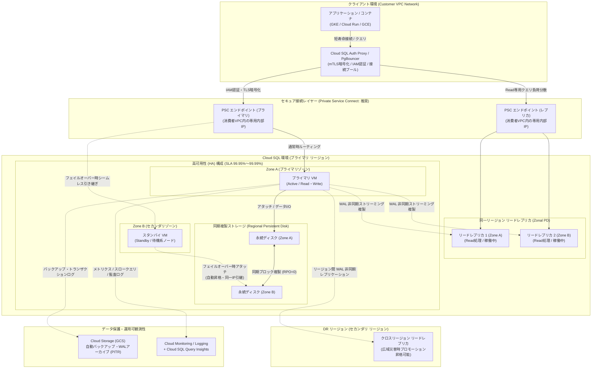

# Cloud SQL for PostgreSQL アーキテクチャ構成図

Google Cloudが提供するフルマネージドのリレーショナルデータベースサービス「Cloud SQL for PostgreSQL」の本番エンタープライズ向けアーキテクチャ構成図および詳細解説です。

---

## 1. システム構成図 (Mermaid)

---

## 2. 主要コンポーネントと動作仕様の解説

### ① プライマリ インスタンス (Primary Instance / HA 構成)
* **役割:** データベースへの書き込み（Read/Write）および読み取りトランザクションを処理するメインインスタンスです。
* **高可用性 (HA: High Availability) の仕組み:**
  * **プライマリ VM (Active):** プライマリゾーン（例: Zone A）で稼働し、クライアントからのすべての書込・読取トランザクションを処理します。
  * **スタンバイ VM (Standby):** セカンダリゾーン（例: Zone B）に配置されます。通常時はディスクをマウントせず待機しており、トラフィックは処理しません。
  * **Regional Persistent Disk (Regional PD):** プライマリゾーンとセカンダリゾーンの2つのゾーンに跨ってストレージレベルで同期書き込み（Synchronous Replication）が行われます。これにより、プライマリVMへのデータ書き込み完了時点で、両ゾーンにデータが完全に二重化されます（**RPO=0**）。
  * **自動フェイルオーバー:** プライマリVMまたはZone Aに障害が発生した場合、ヘルスチェックが異常を検知し、スタンバイVMへセカンダリゾーンのディスクが自動アタッチされ、インスタンスが昇格・起動します。
  * **同一 IP の引き継ぎ:** フェイルオーバー時、クライアント向けのエンドポイント IP アドレスは同一の IP がそのまま引き継がれるため、アプリケーション側で接続先 IP を変更する必要はありません（ただし、既存 TCP コネクションは切断されるため、アプリ側での自動再接続・リトライハンドリングが必須）。

### ② リードレプリカと災害復旧 (Read Replicas & DR)
* **同一リージョン リードレプリカ:**
  * **WAL 非同期ストリーミングレプリケーション:** PostgreSQL標準の Write-Ahead Logging ストリーミング機能を用いて、プライマリからレプリカへ非同期でログを転送・適用します。プライマリの書き込み性能に影響を与えませんが、負荷集中時にはわずかなレプリケーション遅延（Replication Lag）が生じる可能性があります。
  * **個別ストレージ (Zonal PD):** 各リードレプリカは専用の永続ディスクを保持します。レプリカ追加ごとに同等のストレージ課金が発生します。
* **クロスリージョン リードレプリカ (Disaster Recovery: DR):**
  * プライマリとは異なるリージョン（例: 東京リージョンに対して大阪リージョン）にレプリカを配置できます。
  * 大規模災害やリージョン全損時、このレプリカをスタンドアロンのプライマリインスタンスへ手動またはスクリプトで**プロモーション（昇格）**させることで、迅速な事業継続（DR）を実現します。
* **リードレプリカの負荷分散:**
  * 各レプリカは固有のエンドポイント IP を持ちます。複数レプリカ間でクエリをラウンドロビン等で分散させる場合は、クライアント側ライブラリ、PgBouncer、または内部ロードバランサ等でルーティング制御を行います。

### ③ ネットワーク接続と認証セキュリティ (PSC & IAM 認証)
* **Private Service Connect (PSC: 推奨接続アーキテクチャ):**
  * Google Cloud の最新推奨ネットワーク方式です。利用者の VPC 内に専用の内部 IP アドレス（エンドポイント）を配置して接続します。
  * 従来の Private Services Access (PSA / VPC ピアリング) と異なり、**推移的ルーティング制限を受けず、IP アドレス枯渇や CIDR 重複のリスクを完全に回避**できます。オンプレミスや別 VPC からのハイブリッド接続にも最適です。
* **Cloud SQL Auth Proxy & 言語別コネクタ:**
  * TLS/SSL 証明書の自動発行・自動ローテーション、および mTLS（相互TLS）暗号化トンネルを提供します。パブリック IP を介する場合でも安全に通信可能です。
* **IAM データベース認証:**
  * 静的なパスワードをデータベースユーザーに付与する代わりに、Google Cloud IAM（サービスアカウント）の認証情報を用いた短寿命の OAuth 2.0 アクセストークンでログインします。パスワード漏洩リスクを排除し、クラウドネイティブな権限管理を実現します。

### ④ ストレージ層とデータ保護 (Backup & PITR)
* **永続ディスク (Persistent Disk) の特性:**
  * Google Compute Engine の高耐久性ブロックストレージを採用しています。
  * **自動ストレージ増分 (Automatic Storage Increase):** 残り容量が少なくなった際に自動拡張されますが、**一度拡張したディスク容量を縮小することはできません**。プロビジョニング容量全体に課金が継続するため、予期せぬ肥大化を防ぐアラート監視が推奨されます。
  * **容量上限:** Dedicated-core インスタンスで最大 64 TB（共有コアは最大 3 TB、単一テーブル最大 32 TB）。
* **自動バックアップとポイントインタイムリカバリ (PITR):**
  * **自動バックアップ:** 日次で Cloud Storage (GCS) にスナップショットが保存され、マルチリージョン耐障害性を持ちます。
  * **PITR (Point-in-Time Recovery):** トランザクションログ（WAL）をアーカイブ保持することで、過去 7 日間（設定可能）の**任意の 1 秒単位**の過去時点へ新規インスタンスとして復元できます。誤った `DROP TABLE` やデータ更新オペレーションミスからの迅速な復旧に不可欠です。

### ⑤ 接続管理と運用可観測性 (PgBouncer & Query Insights)
* **コネクション管理 (PgBouncer):**
  * PostgreSQL は接続ごとにプロセスをフォークするため、多数の同時接続（数千コネクション）を扱うとメモリを大量消費します。
  * Cloud Run や GKE などのオートスケーリング環境では、**PgBouncer** をサイドカーや接続レイヤーに配置してコネクションプーリングを実施することが強く推奨されます。
* **Cloud SQL Query Insights (クエリインサイト):**
  * アプリケーションのボトルネックとなっているスロークエリや、CPU・ロック競合の根本原因を GUI 上で直感的に可視化・分析できます。タグ付け機能により、どの API エンドポイントやマイクロサービスからのクエリかを追跡可能です。
* **Cloud Monitoring & 監査ログ:**
  * CPU使用率、メモリ使用量、ストレージ残量、レプリケーション遅延（Replication Lag seconds）、フェイルオーバーイベントを Cloud Monitoring で常時監視・アラート通知します。

---

## 3. エディション比較: Enterprise vs Enterprise Plus

システム要件や SLA に応じて適切なエディションを選定します。

| 項目 | Enterprise エディション | Enterprise Plus エディション |
| :--- | :--- | :--- |
| **主な用途** | 一般的な Web アプリケーション、社内基盤 | ミッションクリティカル、高負荷・低レイテンシ要件 |
| **可用性 SLA (HA構成)** | **99.95%** | **99.99%** |
| **フェイルオーバー時間** | 約 60 秒（通常 30〜60 秒） | **10 秒未満**（データキャッシュ保持） |
| **キャッシュ機構** | なし（通常の OS ページキャッシュ） | **Data Cache (高速 NVMe SSD)** によるインメモリスピード |
| **計画メンテナンス停止** | 通常 60 秒未満 | **10 秒未満のダウンタイム** |
| **最大 vCPU / メモリ** | 最大 96 vCPU / 624 GB RAM | 最大 128 vCPU / 864 GB RAM |
| **機械学習機能** | pgvector 拡張機能対応 | pgvector 最適化 + 高速インデックス |
