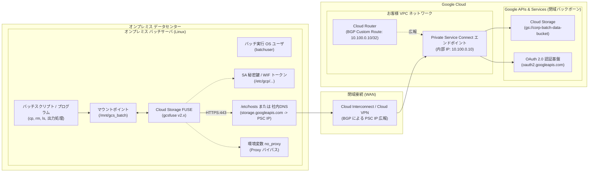
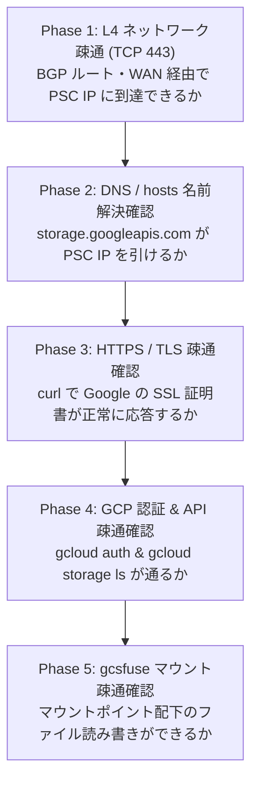
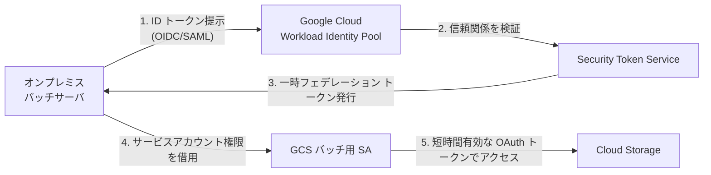

# Cloud Storage オンプレミスバッチサーバ マウント構築ガイド（エンタープライズ版）

オンプレミスデータセンター環境のバッチサーバ（Linux）から、専用線/WANおよび **Private Service Connect (PSC)** を経由して **Google Cloud Storage (GCS)** のバケットをローカルファイルシステムとしてマウント（FUSEマウント）し、安全・堅牢かつ高パフォーマンスにバッチ処理を実行するためのアーキテクチャ設計・構築・運用ガイドです。

---

## 0. Google Cloud プロフェッショナルレビュー所見

本ガイドは、Google Cloud シニアアーキテクト／インフラエンジニアのレビューを経て、**エンタープライズ本番環境で実際に発生する落とし穴とベストプラクティス** を反映しています。

### プロフェッショナル視点での重要チェックポイント

| レビュー領域 | 実装時の落とし穴（注意点） | 推奨ベストプラクティス |
| :--- | :--- | :--- |
| **ルーティング** | PSC の内部 IP を作成しただけでは、オンプレミスからルーティングされない | **Cloud Router の BGP ピアリング設定で PSC IP（またはサブネット）をオンプレミスへ明示的にカスタムルート広報（Custom Route Advertisements）する** |
| **プロキシ回避** | オンプレサーバに社内プロキシ（`http_proxy`）が設定されていると、閉域通信が遮断される | **環境変数 `no_proxy` に `googleapis.com` および PSC IP を必ず指定してプロキシをバイパスする** |
| **認証方式** | サービスアカウントキー（JSON）は長期有効な秘密鍵であり、漏洩リスク・鍵管理負担がある | 初期構築はキー方式で即座に動作確認しつつ、**将来的な本番運用ではキーレス認証「Workload Identity 連携」への移行を計画する** |
| **マウント設定** | CLI フラグのみの運用は保守性が低く、キャッシュが無効だとレイテンシと API 費用が増大する | **最新 gcsfuse v2 系の構成ファイル（`config.yaml`）** を採用し、**ファイルキャッシュ（File Cache）** を有効化する |
| **プロセス管理** | `/etc/fstab` はマウントプロセス異常終了時の自動再起動ができない | 本番バッチ基盤では、プロセスの死活監視と自動リカバリが可能な **systemd サービスユニット** による常駐化を推奨 |
| **課金・コスト** | GCS への頻繁な `ls`（ファイル走査）が大量の Class A API 課金を誘発する | **Stat キャッシュおよびファイルキャッシュをチューニングし、不要なメタデータ問い合わせを抑制する** |

---

## 目次
1. [結論および質問への回答サマリー](#1-結論および質問への回答サマリー)
2. [全体アーキテクチャと通信設計](#2-全体アーキテクチャと通信設計)
   - [2.1 構成図](#21-構成図)
   - [2.2 ネットワーク到達性設計（Cloud Router BGP 広報）](#22-ネットワーク到達性設計cloud-router-bgp-広報)
   - [2.3 社内プロキシ（Proxy）のバイパス設計](#23-社内プロキシproxyのバイパス設計)
3. [事前準備と前提要件](#3-事前準備と前提要件)
   - [3.1 Google Cloud 側の設定（PSC / IAM / GCS）](#31-google-cloud-側の設定psc--iam--gcs)
   - [3.2 オンプレミスサーバ側の要件（OS / FUSE）](#32-オンプレミスサーバ側の要件os--fuse)
4. [オンプレミスバッチサーバの環境構築手順](#4-オンプレミスバッチサーバの環境構築手順)
   - [Step 1: バッチ実行用 OS ユーザの作成](#step-1-バッチ実行用-os-ユーザの作成)
   - [Step 2: 認証情報の配置（サービスアカウントキー / Workload Identity 連携）](#step-2-認証情報の配置サービスアカウントキー--workload-identity-連携)
   - [Step 3: Private Service Connect（PSC）の名前解決設定](#step-3-private-service-connectpscの名前解決設定)
   - [Step 4: Cloud Storage FUSE および gcloud CLI のインストール](#step-4-cloud-storage-fuse-および-gcloud-cli-のインストール)
5. [段階的疎通確認手順（5段階チェックリスト）](#5-段階的疎通確認手順5段階チェックリスト)
   - [Phase 1: L4 レベル導通確認（TCP 443）](#phase-1-l4-レベル導通確認tcp-443)
   - [Phase 2: DNS / hosts 名前解決確認](#phase-2-dns--hosts-名前解決確認)
   - [Phase 3: HTTPS / TLS 接続確認](#phase-3-https--tls-接続確認)
   - [Phase 4: GCP 認証・GCS API 疎通確認（gcloud コマンド）](#phase-4-gcp-認証gcs-api-疎通確認gcloud-コマンド)
   - [Phase 5: gcsfuse マウント疎通確認](#phase-5-gcsfuse-マウント疎通確認)
6. [Cloud Storage のマウント運用と OS コマンド操作](#6-cloud-storage-のマウント運用と-os-コマンド操作)
   - [6.1 最新 gcsfuse v2 系の構成ファイル設計（config.yaml）](#61-最新-gcsfuse-v2-系の構成ファイル設計configyaml)
   - [6.2 手動マウントコマンド](#62-手動マウントコマンド)
   - [6.3 本番運用向け自動マウント方式の選定（systemd vs /etc/fstab）](#63-本番運用向け自動マウント方式の選定systemd-vs-etcfstab)
   - [6.4 標準 OS コマンドによるファイル操作例](#64-標準-os-コマンドによるファイル操作例)
   - [6.5 アンマウント手順](#65-アンマウント手順)
7. [バッチ処理における設計考慮点とベストプラクティス](#7-バッチ処理における設計考慮点とベストプラクティス)
   - [7.1 gcsfuse（マウント）の特性と制限事項](#71-gcsfuseマウントの特性と制限事項)
   - [7.2 「gcsfuse マウント」vs「gcloud CLI / REST API」の使い分け](#72-gcsfuse-マウントvs-gcloud-cli--rest-apiの使い分け)
   - [7.3 コスト最適化（PSC データ処理料と API リクエスト課金）](#73-コスト最適化psc-データ処理料と-api-リクエスト課金)
   - [7.4 セキュリティ推奨：Workload Identity 連携（WIF）の実装](#74-セキュリティ推奨workload-identity-連携wifの実装)
8. [運用監視とトラブルシューティング](#8-運用監視とトラブルシューティング)
   - [8.1 バッチ実行前ヘルスチェックスクリプト](#81-バッチ実行前ヘルスチェックスクリプト)
   - [8.2 よくある障害と対処法](#82-よくある障害と対処法)

---

## 1. 結論および質問への回答サマリー

| # | ご質問 | 回答 | プロフェッショナル視点での補足・留意点 |
| :--- | :--- | :---: | :--- |
| 1 | **オンプレのバッチサーバに GCS をマウントできますか？** | **可能** | Google 公式ツール **`Cloud Storage FUSE (gcsfuse)`** を利用します。最新の v2 系ではローカルファイルキャッシュ機能が強化され、オンプレミスのバッチ処理でも高いスループットを実現できます。 |
| 2 | **OS ユーザを作成し、サービスアカウントキーの配置が必要ですか？** | **はい**<br>（初期導入） | バッチ専用の一般 OS ユーザを作成し、最小権限（`Storage オブジェクト ユーザー`）の JSON 鍵をセキュア（`chmod 600`）に配置します。**将来的なセキュリティ要件に応じて、キーレスの「Workload Identity 連携」への移行が可能** です。 |
| 3 | **PSC の IP アドレスを `/etc/hosts` に記載が必要ですか？** | **はい**<br>（推奨手法あり） | `storage.googleapis.com` および認証用の `oauth2.googleapis.com` を PSC IP に名前解決させます。単体検証では `/etc/hosts`、本番・複数台では **社内 DNS の条件付きフォワーダー** が推奨されます。 |
| 4 | **疎通確認方法はありますか？** | **あります** | ネットワーク L4（nc/curl）→ DNS/hosts → HTTPS/TLS → gcloud 認証・API → gcsfuse マウントの **5 段階** で体系的に切り分け可能です。 |
| 5 | **OS コマンドでコピーや削除ができますか？REST API コマンドが必要ですか？** | **OS コマンドで可能** | マウント後は `cp`, `rm`, `ls`, `mv`, `cat` 等の **通常の Linux OS コマンドで直接操作可能** です。REST API を意識して開発する必要はありません。 |
| 6 | **オンプレのバッチサーバに SDK か何かのダウンロード・インストールが必要ですか？** | **必要**<br>（gcsfuse） | **`gcsfuse`** パッケージおよび OS の `fuse` ライブラリのインストールが必要です。また、疎通テストや大規模並列転送用に **`Google Cloud CLI (gcloud)`** のインストールも強く推奨されます。 |

---

## 2. 全体アーキテクチャと通信設計

### 2.1 構成図

オンプレミスデータセンター内のバッチサーバが、既設の閉域網（Dedicated Interconnect / Partner Interconnect / Cloud VPN）を経由し、Google Cloud VPC 内に配置された **Private Service Connect (PSC) エンドポイント（内部 IP）** を通して Cloud Storage に安全にアクセスします。インターネット経由のトラフィックは一切発生しません。



### 2.2 ネットワーク到達性設計（Cloud Router BGP 広報）

> [!CRITICAL]
> **GCP シニアアーキテクトからの必須指摘**:
> PSC エンドポイントの内部 IP（例: `10.100.0.10`）を作成しただけでは、オンプレミス環境のルータはその IP への経路を知りません。
> **Cloud Router の BGP セッションで、PSC エンドポイントの IP（または配置されたサブネット）をオンプレミス側へ明示的にカスタムルート広報（Custom Route Advertisements）** してください。

- **設定例（Google Cloud 側）**:
  VPC ネットワークの Cloud Router において、BGP ピアリングの設定で **「カスタムルート（Custom Advertised Routes）」** に PSC の IP（例: `10.100.0.10/32`）を追加します。これにより、オンプレミスのルータに自動的に経路が学習されます。

### 2.3 社内プロキシ（Proxy）のバイパス設計

オンプレミス環境の Linux サーバでは、環境変数 `http_proxy` や `https_proxy` に社内フォワードプロキシ（Squid 等）が設定されているケースが一般的です。
PSC は閉域網（プライベート IP）を経由するため、Google API 宛ての通信が社内プロキシに転送されると、名前解決や SSL ネゴシエーションが失敗します。

**対応策: バッチサーバの `no_proxy` に例外を設定する**
```bash
# /etc/environment または batchuser の .bashrc に追記
export no_proxy="localhost,127.0.0.1,storage.googleapis.com,oauth2.googleapis.com,www.googleapis.com,10.100.0.10"
export NO_PROXY="localhost,127.0.0.1,storage.googleapis.com,oauth2.googleapis.com,www.googleapis.com,10.100.0.10"
```

---

## 3. 事前準備と前提要件

### 3.1 Google Cloud 側の設定（PSC / IAM / GCS）

1. **Private Service Connect (PSC) エンドポイントの作成**
   - サービス: `all-apis`（すべての Google API バンドル）
   - 割り当て IP: VPC 内の予約済み内部 IP（例: `10.100.0.10`）
2. **Cloud Storage バケットの準備**
   - リージョン: オンプレミスとの物理距離・レイテンシを最小化するため、国内リージョン（`asia-northeast1` (東京) または `asia-northeast2` (大阪)）を推奨。
   - ストレージクラス: バッチ処理の頻度に応じて `Standard` を選択。
3. **サービスアカウントの作成と最小権限の付与**
   - 必要な権限のみを含むロールをバインドします。
     - **読み書き・削除が必要なバッチ**: `roles/storage.objectUser`（Storage オブジェクト ユーザー）※推奨
     - **読み取り専用バッチ**: `roles/storage.objectViewer`（Storage オブジェクト 閲覧者）

### 3.2 オンプレミスサーバ側の要件（OS / FUSE）

- **対応 OS**: RHEL 8 / 9, Rocky Linux 8 / 9, CentOS Stream, Ubuntu 20.04 / 22.04 / 24.04 等
- **FUSE モジュール**: Linux カーネルの `fuse` モジュールがロードされていること。
- **キャッシュ用空きディスク**: gcsfuse のファイルキャッシュおよび一時書き込みバッファ用として、扱う最大ファイルサイズに応じた十分なローカルディスク空き容量（例: `/var/cache/gcsfuse` に 50GB 以上）。

---

## 4. オンプレミスバッチサーバの環境構築手順

### Step 1: バッチ実行用 OS ユーザの作成

バッチ処理を root ではなく専用の一般ユーザで安全に実行します。

```bash
# 1. バッチ専用グループおよびユーザの作成
sudo groupadd -g 2000 batchgroup
sudo useradd -u 2000 -g batchgroup -m -s /bin/bash batchuser

# 2. マウントポイントディレクトリおよびキャッシュディレクトリの作成
sudo mkdir -p /mnt/gcs_batch
sudo mkdir -p /var/cache/gcsfuse

# 3. 所有権とアクセス権の設定
sudo chown -R batchuser:batchgroup /mnt/gcs_batch
sudo chown -R batchuser:batchgroup /var/cache/gcsfuse
sudo chmod 750 /mnt/gcs_batch
sudo chmod 700 /var/cache/gcsfuse
```

### Step 2: 認証情報の配置（サービスアカウントキー / Workload Identity 連携）

#### 方式 A: サービスアカウントキー（JSON）方式
初期構築や単独システムで標準的に利用される手法です。

```bash
# 1. 鍵配置用ディレクトリの作成
sudo mkdir -p /etc/gcp/keys
sudo chmod 700 /etc/gcp/keys

# 2. サービスアカウントキーを安全に配置（例: gcs-batch-sa-key.json）
# batchuser のみ読み取り可能な 600 パーミッションに設定
sudo chown batchuser:batchgroup /etc/gcp/keys/gcs-batch-sa-key.json
sudo chmod 600 /etc/gcp/keys/gcs-batch-sa-key.json

# 3. batchuser の環境変数に設定
echo 'export GOOGLE_APPLICATION_CREDENTIALS="/etc/gcp/keys/gcs-batch-sa-key.json"' >> /home/batchuser/.bashrc
```

> [!TIP]
> **方式 B: Workload Identity 連携（WIF）** を採用する場合は、鍵ファイル（JSON）の発行は不要です。オンプレミスのトークンプロバイダから取得した認証構成ファイル（Credential Configuration）を配置します（詳細は [7.4 項](#74-セキュリティ推奨workload-identity-連携wifの実装) 参照）。

### Step 3: Private Service Connect（PSC）の名前解決設定

オンプレミスから GCS（`storage.googleapis.com`）および OAuth2 認証（`oauth2.googleapis.com`）にアクセスする際、**PSC の内部 IP アドレス** へ名前解決される必要があります。

#### `/etc/hosts` に記載する場合（単体サーバ・PoC）
```bash
# 例: PSC エンドポイント IP が 10.100.0.10 の場合
sudo tee -a /etc/hosts << 'EOF'

# Google Cloud Private Service Connect (PSC) Endpoints
10.100.0.10 storage.googleapis.com
10.100.0.10 oauth2.googleapis.com
10.100.0.10 www.googleapis.com
EOF
```

#### 社内 DNS（オンプレ DNS）の条件付きフォワーダー（本番推奨）
社内 DNS サーバにて、`googleapis.com` ゾーンに対するフォワード先を PSC IP（または Cloud DNS のインバウンドフォワーダー IP）に指定することで、サーバ個別の hosts メンテナンスを不要にします。

### Step 4: Cloud Storage FUSE および gcloud CLI のインストール

#### RHEL / Rocky Linux 系（dnf / yum）

```bash
# 1. FUSE パッケージのインストール
sudo dnf install -y fuse fuse-libs

# 2. Google Cloud の Yum リポジトリを追加
sudo tee /etc/yum.repos.d/gcsfuse.repo << 'EOF'
[gcsfuse]
name=gcsfuse
baseurl=https://packages.cloud.google.com/yum/repos/gcsfuse-el8-x86_64
enabled=1
gpgcheck=1
repo_gpgcheck=0
gpgkey=https://packages.cloud.google.com/yum/doc/yum-key.gpg
       https://packages.cloud.google.com/yum/doc/rpm-package-key.gpg
EOF

sudo tee /etc/yum.repos.d/google-cloud-sdk.repo << 'EOF'
[google-cloud-cli]
name=Google Cloud CLI
baseurl=https://packages.cloud.google.com/yum/repos/cloud-sdk-el8-x86_64
enabled=1
gpgcheck=1
repo_gpgcheck=0
gpgkey=https://packages.cloud.google.com/yum/doc/yum-key.gpg
       https://packages.cloud.google.com/yum/doc/rpm-package-key.gpg
EOF

# 3. インストール実行
sudo dnf install -y gcsfuse google-cloud-cli

# 4. FUSE の他ユーザ許可設定（/etc/fuse.conf の user_allow_other を有効化）
sudo sed -i 's/#user_allow_other/user_allow_other/g' /etc/fuse.conf
```

#### Ubuntu / Debian 系（apt）

```bash
# 1. 前提パッケージのインストール
sudo apt-get update
sudo apt-get install -y curl apt-transport-https ca-certificates gnupg fuse

# 2. Google Cloud リポジトリ公開鍵とソースリストの追加
curl https://packages.cloud.google.com/apt/doc/apt-key.gpg | sudo gpg --dearmor -o /usr/share/keyrings/cloud.google.gpg

echo "deb [signed-by=/usr/share/keyrings/cloud.google.gpg] https://packages.cloud.google.com/apt gcsfuse-$(lsb_release -c -s) main" | sudo tee /etc/apt/sources.list.d/gcsfuse.list
echo "deb [signed-by=/usr/share/keyrings/cloud.google.gpg] https://packages.cloud.google.com/apt cloud-sdk main" | sudo tee /etc/apt/sources.list.d/google-cloud-sdk.list

# 3. インストール実行
sudo apt-get update
sudo apt-get install -y gcsfuse google-cloud-cli

# 4. FUSE 設定変更
sudo sed -i 's/#user_allow_other/user_allow_other/g' /etc/fuse.conf
```

---

## 5. 段階的疎通確認手順（5段階チェックリスト）

障害発生時の切り分けを迅速化するため、**下位レイヤから順に 5 段階** でテストします。



### Phase 1: L4 レベル導通確認（TCP 443）
WAN および BGP 広報を通じて、オンプレミスから GCP 内の PSC IP（`10.100.0.10`）の TCP 443 番ポートに疎通できるか確認します。

> [!NOTE]
> PSC のフォワーディングルールは ICMP（ping）に応答しません。`nc` (netcat) または `curl` で確認します。

```bash
# nc コマンド（戻り値 0 であれば導通成功）
nc -zv 10.100.0.10 443

# または curl コマンド
curl -v telnet://10.100.0.10:443
```
*※ タイムアウトする場合は、BGP カスタムルート広報、またはオンプレミス側ファイアウォール（443 outbound）の設定を確認してください。*

### Phase 2: DNS / hosts 名前解決確認
オンプレミスサーバが `storage.googleapis.com` および `oauth2.googleapis.com` を PSC の内部 IP に解決できているか確認します。

```bash
getent hosts storage.googleapis.com
getent hosts oauth2.googleapis.com

# 期待される出力:
# 10.100.0.10     storage.googleapis.com
# 10.100.0.10     oauth2.googleapis.com
```

### Phase 3: HTTPS / TLS 接続確認
PSC エンドポイントを介して、Google の正規 SSL/TLS 証明書が正しくネゴシエーションできるか確認します。社内プロキシが干渉していないかも併せて確認できます。

```bash
curl -vI https://storage.googleapis.com/

# 期待される確認項目:
# - Connected to storage.googleapis.com (10.100.0.10) port 443
# - Server certificate: CN=upload.video.google.com または *.googleapis.com
# - HTTP/2 200 または HTTP/2 403 / 401（認証前のため何らかの HTTP 応答があれば正常）
```

### Phase 4: GCP 認証・GCS API 疎通確認（gcloud コマンド）
サービスアカウントキーを用いて認証を通し、GCS バケットの一覧が取得できるかテストします。

```bash
# batchuser にスイッチ
sudo su - batchuser

# サービスアカウントをアクティベート
gcloud auth activate-service-account --key-file=/etc/gcp/keys/gcs-batch-sa-key.json

# 対象バケットの中身をリスト表示
gcloud storage ls gs://corp-batch-data-bucket/
```
バケット内のオブジェクト一覧が表示されれば、**ネットワーク・名前解決・認証・IAM 権限のすべてが完全に正常** です。

### Phase 5: gcsfuse マウント疎通確認
テスト用ディレクトリへ一時的にマウントし、ファイルの書き込み・読み込みをテストします。

```bash
# batchuser で実行
mkdir -p /tmp/gcs_test
gcsfuse --key-file=/etc/gcp/keys/gcs-batch-sa-key.json corp-batch-data-bucket /tmp/gcs_test

# 書き込み & 読み込みテスト
echo "test connection $(date)" > /tmp/gcs_test/healthcheck.txt
cat /tmp/gcs_test/healthcheck.txt
rm /tmp/gcs_test/healthcheck.txt

# アンマウント
fusermount -u /tmp/gcs_test
rmdir /tmp/gcs_test
```

---

## 6. Cloud Storage のマウント運用と OS コマンド操作

### 6.1 最新 gcsfuse v2 系の構成ファイル設計（config.yaml）

最新の gcsfuse では、CLI オプションの長大化を防ぎ保守性を高めるため、**構成ファイル（YAML）** による設定管理が推奨されています。

```bash
# 構成ファイル配置用ディレクトリの作成
sudo mkdir -p /etc/gcsfuse
sudo chown batchuser:batchgroup /etc/gcsfuse
```

```yaml
# /etc/gcsfuse/config.yaml
logging:
  severity: warning
  file: /var/log/gcsfuse.log
  log-rotate:
    max-file-size-mb: 100
    backup-file-count: 5
    compress: true

file-cache:
  max-size-mb: 10240            # ローカルキャッシュ最大 10GB（バッチの繰り返し読み込みを劇的に高速化）
  cache-file-for-range-read: true

metadata-cache:
  stat-cache-max-size-mb: 64
  ttl-secs: 300                 # メタデータキャッシュ 5分（余計な LIST API 呼び出しと課金を抑制）
  type-cache-max-size-mb: 16

file-system:
  ignore-interrupts: true       # バッチ処理中のシグナルによる中断を防止
```

### 6.2 手動マウントコマンド

```bash
# batchuser での推奨手動マウント
gcsfuse \
  --config-file=/etc/gcsfuse/config.yaml \
  --key-file=/etc/gcp/keys/gcs-batch-sa-key.json \
  --temp-dir=/var/cache/gcsfuse \
  --implicit-dirs \
  --uid=2000 \
  --gid=2000 \
  --file-mode=0660 \
  --dir-mode=0770 \
  corp-batch-data-bucket /mnt/gcs_batch
```

### 6.3 本番運用向け自動マウント方式の選定（systemd vs /etc/fstab）

#### 方式 1: systemd サービスユニットによる常駐マウント（本番推奨）
`/etc/fstab` は OS 起動時にマウントするのみですが、**systemd を用いるとプロセス異常終了時の自動再起動（Auto Restart）** が行われるため、バッチ基盤の高可用性運用に最適です。

```ini
# /etc/systemd/system/gcsfuse-mount.service
[Unit]
Description=Cloud Storage FUSE Mount for Batch Processing
After=network-online.target
Wants=network-online.target

[Service]
Type=forking
User=batchuser
Group=batchgroup
Environment="no_proxy=localhost,127.0.0.1,storage.googleapis.com,oauth2.googleapis.com,10.100.0.10"
ExecStart=/usr/bin/gcsfuse \
  --config-file=/etc/gcsfuse/config.yaml \
  --key-file=/etc/gcp/keys/gcs-batch-sa-key.json \
  --temp-dir=/var/cache/gcsfuse \
  --implicit-dirs \
  --uid=2000 \
  --gid=2000 \
  --file-mode=0660 \
  --dir-mode=0770 \
  corp-batch-data-bucket /mnt/gcs_batch
ExecStop=/usr/bin/fusermount -u /mnt/gcs_batch
Restart=on-failure
RestartSec=10s

[Install]
WantedBy=multi-user.target
```

```bash
# サービスの有効化と起動
sudo systemctl daemon-reload
sudo systemctl enable --now gcsfuse-mount.service

# ステータス確認
systemctl status gcsfuse-mount.service
df -hT /mnt/gcs_batch
```

#### 方式 2: `/etc/fstab` による定義（シンプル構成）
```fstab
# /etc/fstab への設定例
corp-batch-data-bucket /mnt/gcs_batch gcsfuse rw,_netdev,allow_other,implicit_dirs,config_file=/etc/gcsfuse/config.yaml,key_file=/etc/gcp/keys/gcs-batch-sa-key.json,temp_dir=/var/cache/gcsfuse,uid=2000,gid=2000,file_mode=0660,dir_mode=0770 0 0
```
*※ `_netdev` オプションはネットワーク確立後のマウントを保証するために必須です。*

### 6.4 標準 OS コマンドによるファイル操作例

マウントが完了すれば、**通常のローカルストレージや NFS と全く同様に Linux OS コマンドで操作可能** です。

```bash
# 1. 入力データの一覧表示 (ls)
ls -lh /mnt/gcs_batch/input_data/

# 2. ローカルから GCS へのファイル書き込み (cp)
cp /var/data/export_20261009.csv /mnt/gcs_batch/input_data/

# 3. GCS 上のファイル参照 (head, grep, cat)
head -n 20 /mnt/gcs_batch/input_data/export_20261009.csv

# 4. GCS からローカルへのダウンロード (cp)
cp /mnt/gcs_batch/output/daily_summary.tar.gz /var/backup/

# 5. ファイルの削除 (rm)
rm -f /mnt/gcs_batch/input_data/processed_file.tmp

# 6. バッチスクリプトからの直接リダイレクト書き込み
python3 /opt/batch/job_runner.py > /mnt/gcs_batch/logs/job_$(date +%Y%m%d).log 2>&1
```

### 6.5 アンマウント手順

```bash
# 通常のアンマウント
fusermount -u /mnt/gcs_batch

# 使用中プロセスがあり外せない場合の遅延強制アンマウント
fusermount -uz /mnt/gcs_batch
```

---

## 7. バッチ処理における設計考慮点とベストプラクティス

### 7.1 gcsfuse（マウント）の特性と制限事項

1. **アトミック性の欠如（ディレクトリの mv / rename）**:
   - GCS には本質的に「ディレクトリ」が存在しません。ディレクトリの `mv` は、配下の全オブジェクトを 1 つずつコピーした後に元を削除するため、数万ファイルある場合は大量の API コストと長い処理時間が発生します。
2. **追記書き込み（Append）の挙動**:
   - オブジェクトストレージはオブジェクト全体の再作成が基本です。追記モード（`>>`）でファイルを開くと、全体がいったんローカルにキャッシュされ、クローズ時に全体が再アップロードされます。頻繁な追記書き込みは避け、ローカルで完結させた後に一括 `cp` する設計が推奨されます。
3. **ファイルロック（flock）の非サポート**:
   - 複数サーバからの同一ファイルに対する排他的なファイルロック（POSIX ロック）は効きません。同時書き込みの排他制御はバッチスケジューラ側で担保する必要があります。

### 7.2 「gcsfuse マウント」vs「gcloud CLI / REST API」の使い分け

| 評価項目 | gcsfuse マウント方式 | gcloud CLI 直接実行 (`gcloud storage cp`) |
| :--- | :--- | :--- |
| **主な用途** | **既存バッチの無改修移行**<br>ローカルパスを前提としたアプリ | **大容量データの一括高速同期**<br>夜間バッチ、数万ファイルの同期 |
| **コマンド形式** | 通常の OS コマンド（`cp`, `rm`, `cat` 等） | `gcloud storage cp -m /path gs://bucket/` |
| **スループット** | 中程度〜高速（ファイルキャッシュ有効時） | **最高速**（マルチスレッド並列・チャンク分割転送） |
| **障害耐性** | 通信断時に I/O エラーとなりやすい | チャンク単位の自動リトライ・再開（レジューム）可能 |
| **推奨利用シーン** | 1ファイル数MB〜数百MBの個別処理、ログ出力 | 1ファイル数十GB超の大規模データ、大量一括転送 |

### 7.3 コスト最適化（PSC データ処理料と API リクエスト課金）

1. **Private Service Connect データ処理料金**:
   - PSC を通過するトラフィックには **約 $0.01 / GB のデータ処理料金** が発生します。不要な大容量データの転送を抑える設計が必要です。
2. **GCS API リクエスト課金の抑制**:
   - `ls -R` やディレクトリ走査を頻繁に行うと、GCS Class A/B オペレーション費用が跳ね上がります。本ガイドで提示した `config.yaml` の **`metadata-cache`（TTL 300秒以上）** を必ず設定し、キャッシュヒット率を高めてください。

### 7.4 セキュリティ推奨：Workload Identity 連携（WIF）の実装

サービスアカウントキーの定期更新運用（90日ローテーション等）を回避し、セキュリティリスクを根本から排除するための推奨構成です。



- **メリット**: サーバ上に長期有効な秘密鍵（JSON）を置く必要がなく、万が一サーバが侵害されても永続的な不正利用を防げます。
- **実装**: 社内の IdP（Active Directory / Okta / Keycloak / AWS など）と GCP Workload Identity Pool を連携させ、生成された `credential-configuration.json` を `GOOGLE_APPLICATION_CREDENTIALS` に指定することで、gcsfuse もキーレスで自動認証可能です。

---

## 8. 運用監視とトラブルシューティング

### 8.1 バッチ実行前ヘルスチェックスクリプト

バッチジョブが開始される直前にマウント状態を検証し、ネットワーク断やアンマウント状態での「ローカルディスクへの誤書き込み」を防ぐためのガードスクリプトです。

```bash
#!/bin/bash
# /opt/batch/bin/check_gcs_mount.sh
set -euo pipefail

MOUNT_POINT="/mnt/gcs_batch"

# 1. マウントポイントが FUSE でマウントされているか検証
if ! mountpoint -q "$MOUNT_POINT"; then
    echo "ERROR: $MOUNT_POINT is not mounted!" >&2
    exit 1
fi

# 2. 読み取りテスト（タイムアウト 5 秒）
if ! timeout 5 ls "$MOUNT_POINT" > /dev/null 2>&1; then
    echo "ERROR: $MOUNT_POINT is hung or not responding!" >&2
    exit 1
fi

echo "SUCCESS: GCS mount point is healthy."
exit 0
```

### 8.2 よくある障害と対処法

| 症状 / エラーメッセージ | 主な原因 | 対処方法 |
| :--- | :--- | :--- |
| **`Connection timed out`** | オンプレミスから PSC 内部 IP へのルーティングが存在しない、または FW 遮断 | **Cloud Router の BGP ピアで PSC IP のカスタムルートがオンプレ側へ広報されているか**、および FW 443 を確認する。 |
| **プロキシ経由エラー / 403 Forbidden** | 社内プロキシ（`http_proxy`）に PSC 宛て通信が巻き込まれている | 環境変数 `no_proxy` に `storage.googleapis.com,oauth2.googleapis.com,10.100.0.10` を設定する。 |
| **`fusermount: option allow_other only allowed if 'user_allow_other' is set`** | `/etc/fuse.conf` の設定不備 | `/etc/fuse.conf` の `user_allow_other` の行頭コメントアウト（`#`）を外す。 |
| **`Transport endpoint is not connected`** | WAN 一時瞬断等により FUSE プロセスが異常終了 | `fusermount -uz /mnt/gcs_batch` を実行後、`systemctl restart gcsfuse-mount` で復旧する。 |
| **`Input/output error` (書き込み中)** | 一時ディレクトリ（`--temp-dir`）のディスク容量枯渇 | 十分な空き容量のあるパーティション（`/var/cache/gcsfuse` 等）を指定する。 |
| **`AccessDenied`** | サービスアカウントの IAM 権限不足 | GCP コンソールで、SA に `roles/storage.objectUser` が付与されているか確認する。 |

---

## 9. まとめ

- **Cloud Storage FUSE（gcsfuse v2.x）** を使用することで、オンプレミスバッチサーバから GCS をローカルディレクトリとして透過的にマウント可能です。
- **Private Service Connect (PSC)** と **Cloud Router の BGP カスタムルート広報** を正しく組み合わせることで、完全閉域でのセキュアな高速データパイプラインを確立できます。
- 既存のバッチ資産（OS コマンド・シェルスクリプト）はそのまま活用しつつ、大容量バッチ転送には `gcloud storage cp` を併用する「ハイブリッド運用」が最も推奨されるエンタープライズ構成です。
