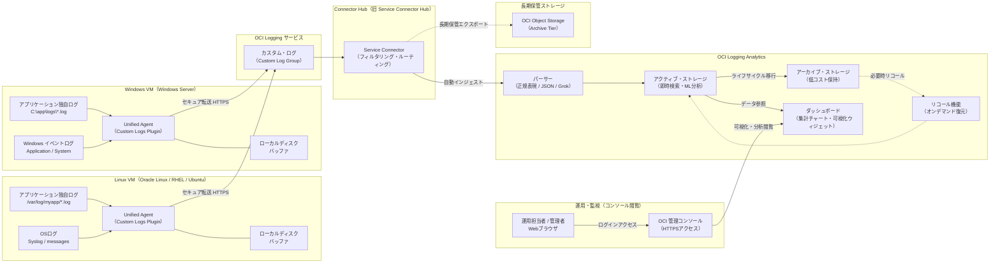
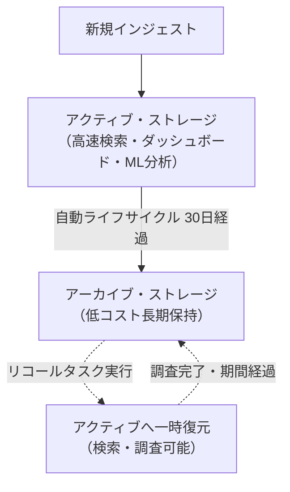
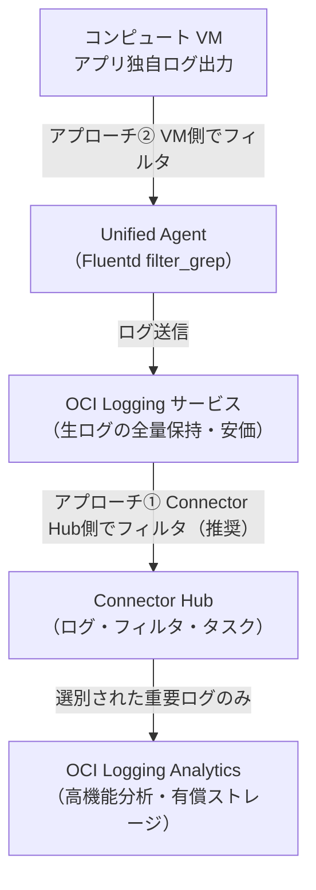
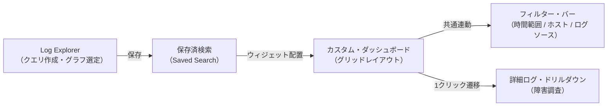
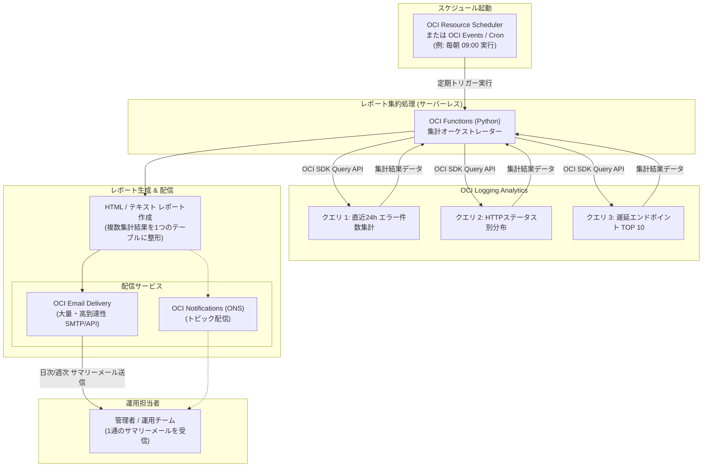

# OCI Logging Analytics 導入・運用ガイド

本ドキュメントでは、Oracle Cloud Infrastructure (OCI) における **OCI Logging Analytics** を活用したログ収集・統合分析・長期保管アーキテクチャ、導入手順、機能特性、およびスケジュール集計メール送信の実装方式について解説します。

---

## 1. 全体アーキテクチャ構成図

指定されたデータフロー `[VM:Unified Agent] -> [OCI Logging Service] -> [OCI Logging Analytics] -> [アーカイブストレージ(長期保管)]` を実現する OCI 標準アーキテクチャです。



### アーキテクチャの解説
1. **VM (Unified Agent)**: 
   - **Linux VM**: Oracle Linux、RHEL、Ubuntu 上で動作し、Syslog や `/var/log/` 配下のアプリケーション独自ログを収集。
   - **Windows VM**: Windows Server 上で動作し、Windows イベントログ（Application/System等）や `C:\` ドライブ配下のログファイルを収集。
   - いずれの OS でも、ネットワーク断時はローカルディスクバッファに一時退避し、ログの取りこぼしを防止。
2. **OCI Logging Service**: 各 VM から収集されたログを「カスタム・ログ」としてセキュアかつスケーラブルに集約。
3. **Connector Hub (旧 Service Connector Hub)**: OCI Logging から OCI Logging Analytics へのデータ連携をサーバーレスかつ低レイテンシで中継（必要に応じてログフィルタを実行）。
4. **OCI Logging Analytics**:
   - **パーサー**: 多様なログ形式をフィールド分割・正規化。
   - **アクティブ・ストレージ**: インデックス化され、即時検索、機械学習クラスタリング、ダッシュボード表示が可能。
   - **アーカイブ・ストレージ**: 保存期間が経過したログを低コストなアーカイブ層へ自動移動。必要時は「リコール」で即座にアクティブ層へ復元可能。
   - **ダッシュボード**: アクティブストレージ内の集計データを多彩なチャートやテーブルウィジェットでリアルタイムに可視化。
5. **長期保管 (Object Storage Archive Tier)**: 法令対応や数年単位の超長期保存が必要な場合、Connector Hub から Object Storage Archive Tier へ直接エクスポートすることも可能です。
6. **コンソールからのダッシュボード閲覧**: 運用管理者は Web ブラウザから OCI 管理コンソールへアクセスし、ダッシュボードを通じてシステム全体の健全性やエラー発生状況をグラフィカルに俯瞰・ドリルダウン分析できます。

> [!TIP]
> **【プロのアーキテクチャ選定指針：収集方式の比較】**  
> OCI Logging Analytics にログを取り込むルートには、本構成（**Unified Agent 経由**）と、もう1つのネイティブ方式（**Management Agent 直接収集**）が存在します。
> 
> | 比較項目 | ① Unified Agent 経由（本ガイドの構成） | ② Management Agent 直接収集 |
> | :--- | :--- | :--- |
> | **データフロー** | VM → OCI Logging → Connector Hub → Log Analytics | VM → Log Analytics (直接) |
> | **生ログの保持** | **OCI Logging 側に安価に全量保持可能**（監査・調査用） | Log Analytics 側のみに保持 |
> | **コスト制御** | **Connector Hub でフィルタし、重要ログのみ分析層へ送れる** | 取り込んだログすべてが Log Analytics 課金対象 |
> | **外部SIEM連携** | OCI Logging や Connector Hub から Splunk/Datadog へ同時配信が容易 | Log Analytics からのエクスポートが必要 |
> | **推奨される状況** | **エンタープライズの標準構成**。<br/>生ログを低コストで保持しつつ、高機能分析層のコストを絞り込みたい場合。 | システムリソース監視（MACS）と統合し、OCI コンソールのみで完結させたい場合。 |

---

## 2. OCI提供仮想マシン (OSバージョン一覧)

OCI コンピュートの「プラットフォーム・イメージ (Platform Images)」および公式提供イメージで利用可能な主要 OS バージョン一覧です。

| OS カテゴリ | 提供バージョン | 提供形態 / ライセンス体系 | 備考 |
| :--- | :--- | :--- | :--- |
| **Oracle Linux** | - Oracle Linux 9 (9.x) - UEK R7 / RHCK<br/>- Oracle Linux 8 (8.x) - UEK R6/R7 / RHCK<br/>- Oracle Linux 7 (7.x) - UEK R5/R6 | - プラットフォーム・イメージ (標準)<br/>- ライセンス費用無料 (OCI利用特典) | OCI に最適化された標準 OS。<br/>Oracle Premier Support、Ksplice (無停止パッチ)、OS Management Hub が追加料金なしで利用可能。<br/>x86_64 および Arm (Ampere A1) 対応。 |
| **Windows Server** | - Windows Server 2025 Standard / Datacenter<br/>- Windows Server 2022 Standard / Datacenter<br/>- Windows Server 2019 Standard / Datacenter<br/>- Windows Server 2016 Datacenter | - プラットフォーム・イメージ<br/>- ライセンス込み (Oracle-Provided)<br/>- ライセンス持ち込み (BYOL) | x86_64 アーキテクチャ対応。<br/>最新の 2025 から 2016 まで幅広く提供。 |
| **Red Hat Enterprise Linux (RHEL)** | - Red Hat Enterprise Linux 9 (9.x)<br/>- Red Hat Enterprise Linux 8 (8.x)<br/>- Red Hat Enterprise Linux 7 (7.x) | - パートナー・イメージ / Marketplace (CCSP)<br/>- カスタム・イメージ (BYOI) | OracleとRed Hatの提携により、OCIコンソールから直接デプロイ可能。 |
| **Ubuntu** | - Ubuntu 24.04 LTS (Noble Numbat)<br/>- Ubuntu 22.04 LTS (Jammy Jellyfish)<br/>- Ubuntu 20.04 LTS (Focal Fossa) | - プラットフォーム・イメージ (Canonical公式)<br/>- ライセンス費用無料 (オープンソース) | Canonical 最適化イメージ。<br/>x86_64 および Arm (Ampere A1) 対応。 |

---

## 3. Unified Agent

### 3.1 導入可能な各OSバージョン一覧

Unified Agent は、OCI の「**Oracle Cloud Agent (OCA)**」内の「**カスタム・ログ・モニタリング (Custom Logs Monitoring)**」プラグインとして動作します。オープンソースの Fluentd をベースに OCI 向けに最適化された高信頼エージェントです。

| OS | Unified Agent (Custom Logs Monitoring) 対応バージョン | 制限・注意事項 |
| :--- | :--- | :--- |
| **Oracle Linux** | - Oracle Linux 10<br/>- Oracle Linux 9 (Non-FIPS / FIPS / ARM)<br/>- Oracle Linux 8 (Non-FIPS / FIPS / ARM)<br/>- Oracle Linux 7 (Non-FIPS / FIPS) | - OCI 最適化 OS のため最も安定かつフル機能対応。<br/>- UEK (Unbreakable Enterprise Kernel) および RHCK の両方に対応。 |
| **Windows Server** | - Windows Server 2025<br/>- Windows Server 2022<br/>- Windows Server 2019<br/>- Windows Server 2016 | - x86_64 のみ対応。<br/>- Windows イベントログ (Application, System, Security) およびファイルパス指定ログの収集に対応。 |
| **RHEL** | - RHEL 10<br/>- RHEL 9 (Non-FIPS / FIPS / ARM)<br/>- RHEL 8 (Non-FIPS / FIPS / ARM) | - RHEL 8/9 は FIPS モードおよび ARM アーキテクチャでも動作サポート。 |
| **Ubuntu** | - Ubuntu 24.04 LTS<br/>- Ubuntu 20.04 LTS<br/>*(※旧環境: Ubuntu 18.04 / 16.04 もエージェント動作実績あり)* | - Ubuntu 22.04 / 24.04 では Oracle Cloud Agent の最新バージョンが必要。<br/>- Arm-based (Ampere A1) 形状では一部プラグイン制限に留意。<br/>- ※Ubuntu 16.04 / 18.04 は Canonical による標準サポート（EOL）が終了しているため、新規構築では 22.04 / 24.04 LTS を推奨。 |

> [!WARNING]
> **【プロのライフサイクル注意点：CentOS 7 の EOL】**  
> Unified Agent は CentOS 7 でもバイナリ動作しますが、**CentOS 7 は 2024 年 6 月 30 日をもって公式サポート終了（EOL）** となっています。セキュリティパッチが提供されないため、本番環境ではバイナリ互換性のある **Oracle Linux 8 / 9** への移行が強く推奨されます。

---

### 3.2 前提条件 (IAMポリシーと動的グループの設定)

エージェントが OCI Logging サービスへログを送信できるようにするため、事前に IAM 設定を行います。

1. **動的グループ (Dynamic Group) の作成**  
   - 名前: `LogAgentInstanceGroup`
   - 一致ルール: コンパートメント内のすべてのインスタンスを対象とする場合
     ```text
     ALL {instance.compartment.id = 'ocid1.compartment.oc1..exampleuniqueID'}
     ```

2. **IAM ポリシーの作成**  
   - ポリシー文:
     ```text
     allow dynamic-group LogAgentInstanceGroup to use log-content in compartment <コンパートメント名>
     ```

---

### 3.3 各OSでのインストール・有効化手順

OCI プラットフォームイメージから作成したインスタンスには、**Oracle Cloud Agent** が標準で導入されています。そのため、基本的には **「Custom Logs Monitoring」プラグインを有効化** するだけで動作します。

#### (1) Oracle Linux の場合

##### 手順 A: OCI コンソールからの有効化（推奨）
1. OCI コンソールで **[コンピュート]** → **[インスタンス]** を開き、対象インスタンスを選択。
2. **[Oracle Cloud Agent]** タブをクリック。
3. プラグイン一覧の **[Custom Logs Monitoring (カスタム・ログ・モニタリング)]** を探す。
4. ステータスが「無効」の場合は、右側の三点メニューから **[有効にする]** を選択（数分で「実行中」に遷移）。

##### 手順 B: CLI でのサービス確認・手動インストール
- **サービスの動作確認**:
  ```bash
  sudo systemctl status oracle-cloud-agent
  ```
- **手動インストール (未導入環境の場合)**:
  Oracle Linux では標準リポジトリから DNF / YUM で即座に導入可能です。
  ```bash
  # Oracle Linux 8 / 9
  sudo dnf install -y oracle-cloud-agent
  sudo systemctl enable --now oracle-cloud-agent

  # Oracle Linux 7
  sudo yum install -y oracle-cloud-agent
  sudo systemctl enable --now oracle-cloud-agent
  ```
- **エージェントログの確認**:
  ```bash
  sudo tail -f /var/log/oracle-cloud-agent/plugins/oci-onboarding/unified-monitoring-agent.log
  ```

---

#### (2) Windows Server の場合

##### 手順 A: OCI コンソールからの有効化（推奨）
1. OCI コンソールで **[コンピュート]** → **[インスタンス]** を開き、対象インスタンスを選択。
2. **[Oracle Cloud Agent]** タブをクリック。
3. プラグイン一覧の **[Custom Logs Monitoring (カスタム・ログ・モニタリング)]** を探す。
4. ステータスが「無効」の場合は、右側の三点メニューから **[有効にする]** を選択（数分で「実行中」に遷移）。

##### 手順 B: 手動インストール / サービス起動確認（必要な場合）
- **サービスの確認**:  
  管理者 PowerShell を開き、エージェントサービスの状態を確認します。
  ```powershell
  Get-Service -Name "OracleCloudAgent"
  Get-Service -Name "OracleCloudAgentUpdater"
  ```
- **新規手動インストール (カスタムVMやエージェント未導入時)**:  
  OCI コンピュートドキュメントから提供されている Oracle Cloud Agent の MSI インストーラーをダウンロードし、管理者権限で実行します。
  ```powershell
  msiexec.exe /i OracleCloudAgentSetup.msi /quiet /qn /norestart
  ```

---

#### (3) Red Hat Enterprise Linux (RHEL) の場合

##### 手順 A: OCI コンソールからの有効化（推奨）
1. 対象インスタンスの詳細画面で **[Oracle Cloud Agent]** タブを開く。
2. **[Custom Logs Monitoring]** プラグインを **[有効にする]** に切り替える。

##### 手順 B: CLI でのサービス確認・手動インストール
- **サービスの動作確認**:
  ```bash
  sudo systemctl status oracle-cloud-agent
  ```
- **手動インストール (未導入環境の場合)**:
  RHEL 8 / 9 では OCI の Yum/DNF リポジトリまたは RPM パッケージから導入します。
  ```bash
  # RHEL 8 / 9
  sudo dnf install -y oracle-cloud-agent
  sudo systemctl enable --now oracle-cloud-agent
  ```
- **エージェントログの確認**:
  ```bash
  sudo tail -f /var/log/oracle-cloud-agent/plugins/oci-onboarding/unified-monitoring-agent.log
  ```

---

#### (4) Ubuntu の場合

##### 手順 A: OCI コンソールからの有効化（推奨）
1. 対象インスタンスの詳細画面で **[Oracle Cloud Agent]** タブを開く。
2. **[Custom Logs Monitoring]** プラグインを **[有効にする]** に切り替える。

##### 手順 B: CLI でのサービス確認・手動インストール
- **サービスの動作確認**:
  ```bash
  sudo systemctl status oracle-cloud-agent
  # または Snap の場合
  sudo snap services oracle-cloud-agent
  ```
- **手動インストール (未導入環境の場合)**:
  Ubuntu では Snap または Deb パッケージ経由で導入されます。
  ```bash
  # Snap を利用したインストール
  sudo snap install oracle-cloud-agent --classic
  sudo systemctl enable --now snap.oracle-cloud-agent.oracle-cloud-agent.service
  ```

---

### 3.4 OCI Logging でのエージェント構成 (Agent Configuration) 作成

プラグイン有効化後、実際に「どのファイルを収集するか」を OCI Logging 側で定義します。

1. OCI コンソールで **[アイデンティティとセキュリティ]** → **[ロギング]** → **[エージェント構成]** を選択。
2. **[エージェント構成の作成]** をクリック。
3. **基本情報**:
   - 名前: `App-Log-Collection-Config`
   - ホスト・グループ: 前述の動的グループ (`LogAgentInstanceGroup`) または対象インスタンスを選択。
4. **ログ入力の構成**:
   - **入力タイプ**: `ログ・ファイル` (Windowsイベントログの場合は `Windowsイベント・ログ`)
   - **入力名**: `app-custom-log`
   - **ファイル・パス**:
     - Linux: `/var/log/myapp/*.log`
     - Windows: `C:\inetpub\logs\LogFiles\*.log` または `C:\app\logs\app.log`
   - **パーサー**: `JSON`、`CSV`、`TSV`、`SYSLOG`、または `NONE` (そのまま転送)
5. **ログの送信先**:
   - コンパートメント、ログ・グループ、カスタム・ログ名を指定して作成。

---

## 4. OCI Logging Analytics の機能・特徴

### 4.1 アプリ独自ログの解析
OCI Logging Analytics は、構造化データ・非構造化データを問わず、独自形式のアプリケーションログを柔軟に解析・可視化できます。

- **カスタム・パーサー (Custom Parsers)**:
  - **対応フォーマット**: JSON、CSV/TSV、正規表現 (Regex)、Grok パターン、区切り文字形式、XML。
  - **自動フィールド抽出**: ログ本文から IP アドレス、HTTP メソッド、ステータスコード、レスポンスタイム、トランザクションID などを自動抽出。
  - **ヘッダー/複数行 (Multi-line) ログ対応**: Java のスタックトレースや複数行にまたがるエラーログも 1 レコードとして確実に結合・解析。
- **ログ・ソース (Log Sources)**:
  - ログの種類（例: WebLogic, Apache, 自作マイクロサービス）ごとにソースを定義し、パーサーとマッピング。
- **機械学習クラスタリング (Log Clustering)**:
  - 数百万件の膨大なログから数字や日時の差異を無視し、同一パターンのメッセージを自動的にクラスタ（集約）化。
  - **外れ値検知 (Outlier)**: 通常時は発生しない「未知の新規エラースタック」を即座に浮き彫りにします。

---

### 4.2 ログの取りこぼし防止（24/365 高信頼性）
エンタープライズのミッションクリティカルな要件を満たすため、エージェントからインジェスト層まで多重の堅牢化が図られています。

- **エージェント側のディスクバッファリング**:
  - Unified Agent (Fluentd) は、一時的なネットワーク障害や OCI API のメンテナンスが発生した場合、ログをインスタンスの**ローカルディスクにバッファリング**します。
  - 通信復旧後、バッファされたログを自動的に安全に再送します。
- **指数バックオフ再試行 (Exponential Backoff)**:
  - API レート制限や過負荷が発生しても、エージェントが自動的にリトライ間隔を調整しながら送信を継続し、ログパケットの破棄を防止。
- **OCI Logging 基盤の多重冗長性**:
  - OCI Logging サービスおよび Service Connector Hub はリージョン内のマルチ AD / FD（可用性ドメイン・障害ドメイン）に分散配置されており、単一障害点 (SPOF) のない可用性を誇ります。

---

### 4.3 過去ログの復元・検索（長期保管と調査対応）
インシデント発生時のフォレンジック調査やコンプライアンス監査に備え、ストレージの階層化とオンデマンド復元機能が提供されています。



- **アクティブ・ストレージ (Active Storage)**:
  - 全文インデックスが保持され、クエリ実行やダッシュボード表示、機械学習分析がミリ秒〜秒単位で即座に行える領域（通常 30〜90 日程度保持）。
- **アーカイブ・ストレージ (Archival Storage)**:
  - 保持期間が経過したログを、圧縮されたアーカイブ状態に移行（保持期間は最大数年間設定可能）。
- **リコール (Recall) 機能**:
  - 過去の特定期間（例: 「3か月前の8月10日〜8月12日のWebアクセスログ」）を指定して**リコール**を実行すると、その期間のログのみがアクティブ・ストレージに一時復元されます。
  - 復元されたログは通常のアクティブログと全く同様に OCI コンソールから即座に検索・分析できます。
  - 調査が完了すれば自動的にアン・リコール（再パージ）され、不要なアクティブストレージ課金を抑制できます。

---

### 4.4 課金モデル

OCI Logging および OCI Logging Analytics は従量課金制です。

| サービス / リソース | 課金体系・単価 (目安) | 無料枠 (Always Free / Monthly) | コスト最適化のポイント |
| :--- | :--- | :--- | :--- |
| **OCI Logging** | - インジェスト & ストレージ: 最初の 10 GB 超過後、約 **$0.005 / GB / 月** | **毎月 10 GB まで無料** | 収集対象ログのフィルタリングを行い、不要なデバッグログを除外する。 |
| **Connector Hub**<br/>*(旧 Service Connector Hub)* | **無料** (データ転送自体の追加料金なし) | 常時無料 | Logging から Logging Analytics への転送は Connector Hub 利用が推奨。 |
| **OCI Logging Analytics<br/>(アクティブ・ストレージ)** | - 1 ストレージ・ユニット (300 GB) あたり **$372.00 / 月**<br/>*(1 GB あたり約 $1.24 / 月)* | **毎月 10 GB まで無料** | アクティブ保管期間を必要最小限（例: 14〜30日間）に絞り、速やかにアーカイブへ移行する。 |
| **OCI Logging Analytics<br/>(アーカイブ・ストレージ)** | - 1 ストレージ・ユニット (300 GB) あたり **$0.02 / 時間**<br/>*(300 GB あたり約 $14.40 / 月、1 GB あたり約 $0.048 / 月)* | - | アクティブ層の約 **1/25** のコスト。長期保持ログはアーカイブストレージを活用する。 |
| **Object Storage (Archive)**<br/>*(外部エクスポート時)* | - 約 **$0.0026 / GB / 月** | 毎月 10 GB まで無料 | 3〜7年の監査証跡など、滅多に検索しないデータは Object Storage Archive Tier へ退避。 |

---

### 4.5 ログの絞込設定・除外設定（アプリ独自ログの選別・コスト最適化）

アプリケーションの独自ログには、障害調査に必要な重要ログ（ERROR / EXCEPTION）だけでなく、大量の通常ログ（INFO）や定期監視ログ（DEBUG / ヘルスチェック）が含まれます。
不要なログを除外して必要なログのみを蓄積することで、**検索性の向上** と **Logging Analytics のストレージ費用（$372/300GB/月）の大幅な削減** を実現できます。

OCI では、ログの絞込・除外を行うレイヤーとして主に **「Connector Hub (SCH) 側（推奨）」** と **「VM側 Unified Agent」** の 2 つのアプローチが提供されています。



---

#### (1) Connector Hub (旧 Service Connector Hub) による絞込・除外（推奨アプローチ）

OCI Logging にはトラブル全容把握のために全ログ（または広範なログ）を安価に保持しつつ、**有償の Logging Analytics には分析対象ログのみを転送・蓄積する** ベストプラクティスです。

##### 設定手順
1. OCI コンソールで **[アナリティクスとAI]** → **[コネクタ・ハブ (Connector Hub)]** を開き、対象コネクタを選択（または新規作成）。
2. **ソース**: `ロギング (Logging)`、**ターゲット**: `ロギング・アナリティクス (Logging Analytics)` を選択。
3. **タスクの構成**: **[ログ・データのフィルタ (Log filter task)]** を追加。

> [!NOTE]
> **【プロのTips：ペイロード構造に応じたフィルタ式の書き方】**  
> Connector Hub のログ・クエリ構文では、エージェント側で設定したパーサー形式によって参照する JSON パスが異なります。  
> - **テキスト行のまま送信した場合 (`NONE` パーサー)**: ログ行全体が `data.logContent` に格納されるため、`data.logContent =~ /.../` で正規表現マッチングを行います。  
> - **JSON パーサーを通した場合**: JSON キーが展開され `data.<キー名>`（例: `data.level`, `data.status`）として直接等価比較・条件分岐が可能です。

##### A. 絞込設定（キーワードに一致する行のみを蓄積）
特定の重要キーワード（例: `ERROR`, `FATAL`, `WARN`, `Exception`）を含むログ行のみを抽出し、Logging Analytics に取り込みます。

- **フィルタ条件 (ログ・クエリ式)**:
  - *非構造化・テキストログの場合*:
    ```text
    data.logContent =~ /ERROR|FATAL|WARN|Exception/
    ```
  - *JSON 構造化ログの場合*:
    ```text
    data.level = 'ERROR' or data.level = 'FATAL' or data.level = 'WARN'
    ```

##### B. 除外設定（キーワードに一致する行を蓄積しない）
定期的なヘルスチェックや大量のデバッグログなど、分析に不要なノイズ行を破棄し、それ以外の行のみを蓄積します。否定演算子 `!` または否定正規表現 `!~` を使用します。

- **フィルタ条件 (ログ・クエリ式)**:
  ```text
  !(data.logContent =~ /DEBUG|healthcheck|kube-probe|ELB-HealthChecker/)
  ```
  *(特定のエンドポイントアクセスを除外する場合)*:
  ```text
  data.logContent !~ /GET \/api\/health/
  ```

---

#### (2) Unified Agent (VM側) による絞込・除外

インスタンスの送信ネットワーク帯域を抑えたい場合や、そもそも OCI Logging への取り込み自体を遮断したい場合に利用します。VM 内の Fluentd 設定で `filter_grep` を定義します。

##### 設定手順
1. VM 内のエージェント設定ディレクトリ（Linux: `/etc/unified-monitoring-agent/conf.d/` または Windows: `C:\oracle-cloud-agent\plugins\oci-onboarding\`）に対象設定を追加。
2. Fluentd の `<filter>` ブロックに `grep` プラグインを記述。

##### A. 絞込設定（キーワードに一致する行のみ収集・送信）
指定した正規表現パターンに合致する行のみを通過させます。
```xml
<filter custom.app.log>
  @type grep
  <regexp>
    key message
    pattern /(ERROR|CRITICAL|Exception|OutOfMemory)/
  </regexp>
</filter>
```

##### B. 除外設定（キーワードに一致する行を破棄・送信しない）
指定したキーワードを含む行をエージェント側で即座にドロップします。
```xml
<filter custom.app.log>
  @type grep
  <exclude>
    key message
    pattern /(DEBUG|healthcheck|GET \/health|keepalive)/
  </exclude>
</filter>
```

---

#### (3) 絞込・除外アプローチの比較と選定指針

| 比較項目 | ① Service Connector Hub (SCH) 方式（推奨） | ② VM側 Unified Agent 方式 |
| :--- | :--- | :--- |
| **設定・運用場所** | OCI コンソール / Terraform（一元管理可能） | 各 VM 内部の設定ファイル（個別管理が必要） |
| **OCI Logging 側の状態** | **全ログが保持される**（生ログの調査が可能） | フィルタ後のログのみ送信（除外ログは消失） |
| **Logging Analytics コスト** | **大幅に削減可能**（選別ログのみインジェスト） | **大幅に削減可能**（選別ログのみインジェスト） |
| **ルール変更の柔軟性** | 即時反映（VM へのログインや再起動不要） | VM 内設定の変更とエージェント再起動が必要 |
| **推奨ユースケース** | - 障害調査用として生ログも一定期間（安価に）残したい場合<br/>- 運用ルールやフィルタ条件をクラウド側で一括管理したい場合 | - VM からの送信トラフィック量を物理的に絞りたい場合<br/>- 機密情報（パスワード等）をクラウドに一切送信したくない場合 |

---

### 4.6 ダッシュボード機能と作成手順（可視化・日常監視）

OCI Logging Analytics の**ダッシュボード機能**は、蓄積された膨大なログデータをグラフィカルに可視化し、システムの稼働状態や障害予兆をひと目で把握するための統合モニタリング画面です。



---

#### (1) ダッシュボードの主要機能

- **多彩な可視化ウィジェット (Visualizations)**:
  - **時系列グラフ (Time Series)**: エラー発生件数やトラフィック量の時間推移を折れ線・面グラフで表示。
  - **円グラフ / ドーナツチャート (Pie Chart)**: HTTP ステータスコード比率やログ重要度（Severity）の分布。
  - **棒グラフ (Bar Chart)**: エラー発生数 TOP 10 のホスト名やエンドポイントを垂直/水平バーで比較。
  - **単一値タイル (KPI Tile)**: 「本日のエラー総数」「平均応答時間」などの重要指標を数値カードで強調。
  - **テーブル (Table)**: 異常ログの詳細一覧や最新イベント履歴を表形式で表示。
- **事前定義ダッシュボード (Out-of-the-Box)**:
  - Oracle が標準提供するテンプレート（Linux システムログ、Windows イベントログ、Kubernetes、データベース、セキュリティ監査など）を即座に利用可能。
- **動的フィルター・バー (Dynamic Filters)**:
  - 画面上部のセレクターから「時間範囲（直近1時間 / 24時間 / 7日間等）」「コンパートメント」「ホスト名」「ログ・ソース」を選択すると、ダッシュボード上の全ウィジェットが連動して一括絞り込みされます。
- **対話的ドリルダウン (Drill-down)**:
  - ウィジェット内のスパイク（突出したエラーバー）をクリックするだけで、その時間帯・条件に絞り込まれた生のログ行（スタックトレース等）へ即座にジャンプできます。

---

#### (2) ダッシュボードの作成手順（ステップ・バイ・ステップ）

ダッシュボードは、**「Log Explorer で集計クエリを作成・保存」→「ダッシュボード画面でウィジェットとして配置」** という直感的なフローで構築します。

##### ステップ 1: Log Explorer で集計クエリとグラフを作成
1. OCI コンソールで **[監視および管理]** → **[ロギング・アナリティクス]** → **[ログ・エクスプローラ]** を開く。
2. 画面上部のクエリバーに、可視化したい集計クエリを入力して実行。
   - **例 1: エラー発生件数の時系列推移 (折れ線グラフ)**:
     ```text
     'Log Group' = 'App-Log-Group' and Severity = 'ERROR' 
     | timestats count as ErrorCount by 'Log Source'
     ```
   - **例 2: HTTP ステータスコード別分布 (円グラフ)**:
     ```text
     'Log Group' = 'App-Log-Group' 
     | stats count by Status
     ```
   - **例 3: レスポンス遅延 TOP 10 (水平棒グラフ)**:
     ```text
     'Log Group' = 'App-Log-Group' and 'Response Time' > 1000 
     | stats avg('Response Time') as AvgTime by URI 
     | sort -AvgTime | top 10
     ```
3. 画面右側の「可視化 (Visualizations)」パレットから、表示形式（折れ線グラフ、円グラフ、棒グラフ等）を選択。

##### ステップ 2: 保存済検索 (Saved Search) として保存
1. 画面右上の **[アクション]** → **[保存]** をクリック。
2. **名前**（例: `App-Error-Trend`）と**コンパートメント**を指定し、**[保存]** をクリック。

##### ステップ 3: ダッシュボードの新規作成
1. コンソールメニューから **[監視および管理]** → **[管理ダッシュボード]**（またはロギング・アナリティクス内の **[ダッシュボード]**）を開く。
2. **[ダッシュボードの作成]** をクリック。
3. **ダッシュボード名**（例: `本番Webアプリ統合監視ダッシュボード`）と説明を入力。

##### ステップ 4: ウィジェットの配置とレイアウト調整
1. 画面左側の「ウィジェット・ライブラリ」から、先ほど作成した「保存済検索」を検索。
2. タイルをダッシュボードのキャンバス上へ**ドラッグ＆ドロップ**。
3. タイルの四隅をドラッグしてサイズを拡大・縮小し、好みのレイアウト（上部に KPI カード、左にエラー推移、右にステータス分布など）に整列。

##### ステップ 5: 共通フィルター・バーの構成
1. 画面上部の **[入力の構成 (Filters)]** をクリック。
2. ダッシュボード全体に適用したいフィルタ（「コンパートメント」「時間範囲」「ログ・ソース」など）を追加。
3. 各ウィジェットがこの共通フィルタと連動するように設定。

##### ステップ 6: 保存と自動更新の設定
1. 画面右上の **[変更の保存]** をクリック。
2. **自動更新 (Auto-Refresh)** の間隔（例: `1分`、`5分`）を設定し、常に最新の稼働状況が表示されるようにします。

---

#### (3) プロが実践するダッシュボード運用のベストプラクティス

1. **運用監視室 (NOC) での常時投影モニター活用**:
   - 自動更新を有効にした全画面モードを活用し、システム障害やトラフィック急増の兆候を NOC 監視チームがリアルタイムに視覚検知。
2. **ダッシュボード定義のエクスポート / インポート (Dashboard as Code)**:
   - 作成したダッシュボードは JSON 形式でエクスポート可能。開発・検証環境から本番環境への移行や、Git によるバージョン管理・Terraform 化が容易です。
3. **閲覧権限の分離 (IAM ポリシー)**:
   - 開発者・運用者にはダッシュボードの「閲覧のみ」権限を付与し、意図しないクエリ変更やレイアウト崩れを防止可能。
   ```text
   # ダッシュボード閲覧専用ポリシー例
   allow group AppViewerGroup to read management-dashboard-family in compartment <コンパートメント名>
   ```

---

## 5. 質問への回答

### Q. スケジュールに従って、ログを集計して、集計結果を何種類かまとめてメール送信できますか？できる場合はどのような構成になりますか？

### 回答: **可能です**

#### 解説と推奨構成
OCI Logging Analytics 標準の「スケジュール済タスク (Saved Search Alert)」機能では、**1つの検索クエリに対して1通のアラートメール**が OCI Notifications 経由で送信される仕様となっています。

そのため、**「複数の異なる集計結果（例: ①エラー件数推移、②ステータスコード別TOP10、③レスポンス遅延エンドポイント一覧）を1通のメールにまとめて定期レポートとして送信したい」** という要件には、**OCI Functions（またはコンピュート/ジョブ）＋ OCI Logging Analytics API ＋ OCI Email Delivery（または Notifications）** を組み合わせたサーバーレス自動集約構成がベストプラクティスとなります。

---

### 5.1 推奨アーキテクチャ構成図 (Mermaid)



---

### 5.2 処理フローの詳細

1. **定期トリガー (OCI Resource Scheduler / OCI Events)**:
   - 設定したスケジュール（例: 毎朝 09:00、毎週月曜など）に従い、イベントを発行して OCI Functions を呼び出します。
2. **集約ファンクション (OCI Functions - Python)**:
   - インスタンス・プリンシパル（またはリソース・プリンシパル）認証を用いて、OCI Python SDK の `LogAnalyticsClient` を呼び出します。
   - 事前に定義した複数のログ検索クエリ（Saved Search または クエリ文字列）を順次または並列に実行します。
3. **複数クエリ結果の結合・フォーマット**:
   - 取得した複数の集計結果（JSON）を解析し、視認性の高い 1 つの HTML メール本文（または Markdown / テキスト形式）に整形します。
4. **メール送信 (OCI Email Delivery / Notifications)**:
   - **OCI Email Delivery**: 送信ドメイン認証（SPF / DKIM）に対応した本格的なメール送信サービス。HTML 表形式の美しいレポート送信に最適。
   - **OCI Notifications**: 簡易的なテキストベースのトピック配信。手軽に通知したい場合に適しています。

---

### 5.3 実装例 (OCI Functions / Python スクリプト骨子)

以下は、OCI Functions で複数クエリを実行して 1 通のメールにまとめる実装イメージです。

```python
import io
import json
import oci
import smtplib
from email.mime.multipart import MIMEMultipart
from email.mime.text import MIMEText
from fdk import response

def handler(ctx, data: io.BytesIO = None):
    # リソース・プリンシパル認証
    signer = oci.auth.signers.get_resource_principals_signer()
    client = oci.log_analytics.LogAnalyticsClient(config={}, signer=signer)
    
    namespace = "your-tenancy-namespace"
    compartment_id = "ocid1.compartment.oc1..example"

    # 実行したい複数の集計クエリ
    queries = {
        "【1】エラー発生件数サマリー": (
            "'Log Group' = 'App-Log-Group' and Severity = 'ERROR' "
            "| stats count as ErrorCount by 'Log Source'"
        ),
        "【2】HTTPステータスコード別集計": (
            "'Log Group' = 'App-Log-Group' "
            "| stats count by Status | sort -count"
        ),
        "【3】応答遅延エンドポイント TOP 5": (
            "'Log Group' = 'App-Log-Group' and 'Response Time' > 1000 "
            "| stats avg('Response Time') as AvgTime, count by URI "
            "| sort -AvgTime | top 5"
        )
    }

    report_html = "<h2>OCI ログ日次集計サマリーレポート</h2><hr/>"

    # 各クエリを順次実行してHTMLテーブルを作成
    for title, query_str in queries.items():
        req = oci.log_analytics.models.QueryDetails(
            query_string=query_str,
            sub_system=oci.log_analytics.models.QueryDetails.SUB_SYSTEM_LOG
        )
        res = client.query(namespace_name=namespace, query_details=req)
        
        report_html += f"<h3>{title}</h3><table border='1' cellpadding='5' style='border-collapse:collapse;'>"
        # カラムヘッダー
        columns = [col.display_name for col in res.data.columns]
        report_html += "<tr>" + "".join([f"<th bgcolor='#f2f2f2'>{c}</th>" for c in columns]) + "</tr>"
        # データ行
        for item in res.data.items:
            report_html += "<tr>" + "".join([f"<td>{val}</td>" for val in item]) + "</tr>"
        report_html += "</table><br/>"

    # OCI Email Delivery 経由でメール送信
    send_email(report_html)

    return response.Response(
        ctx, response_data=json.dumps({"status": "Report Sent Successfully"}),
        headers={"Content-Type": "application/json"}
    )

def send_email(html_body):
    smtp_server = "smtp.email.us-ashburn-1.oci.oraclecloud.com"
    smtp_port = 587
    smtp_user = "ocid1.credential.oc1..example_smtp_user"
    smtp_pass = "Generated_SMTP_Password"

    msg = MIMEMultipart("alternative")
    msg["Subject"] = "[定期レポート] OCI Logging Analytics 日次集計結果"
    msg["From"] = "logging-report@yourdomain.com"
    msg["To"] = "admin-team@yourdomain.com"
    msg.attach(MIMEText(html_body, "html"))

    with smtplib.SMTP(smtp_server, smtp_port) as server:
        server.starttls()
        server.login(smtp_user, smtp_pass)
        server.send_message(msg)
```

---

### 5.4 プロが実践する運用のさらなる高度化（最新ベストプラクティス）

本番運用において、上記アーキテクチャに以下の付加価値を組み込むことで、運用効率と障害初動対応をさらに劇的に引き上げることができます。

1. **OCI コンソールへのディープリンク（ワンクリック詳細ドリルダウン）**:
   - メール内の各集計表の末尾に、OCI Logging Analytics の「ダッシュボード」または「保存済検索（Saved Search）」のコンソール直接 URL（`https://cloud.oracle.com/loganalytics/explorer?searchId=...`）を埋め込みます。
   - メールを受け取った運用者は、ブラウザを開いて手動でクエリを入力することなく、**1 クリックで該当時間帯のミリ秒単位の詳細ログ（スタックトレース等）へ即座にドリルダウン**できます。
2. **OCI Generative AI（生成AI）によるインシデント自動要約（最新トレンド）**:
   - OCI Functions 内で **OCI Generative AI Service**（マネージド LLM）の API を呼び出し、集計された上位エラーログ群をプロンプトとして入力。
   - 「本日の主要エラー要約（例: 本日未明 03:15 に DB コネクションプール枯渇が 15 件発生）」を自然言語で自動生成させ、メール冒頭にインサイトとして掲載します。
3. **アラート疲れ防止（正常時の通知スキップ・サマリー化）**:
   - 全クエリでエラーが 0 件だった場合はメール送信自体をスキップ、または「本日検知された重大イベントはありません」という 1 行サマリーのみに切り替える判定ロジックを入れることで、運用担当者のアラート疲労を抑止します。

---

## 6. まとめ

- **アーキテクチャ**: Unified Agent (Fluentd) から OCI Logging、Connector Hub (旧 Service Connector Hub) を経由して OCI Logging Analytics に集約し、ライフサイクル機能で低コストなアーカイブ層へ自動移行するパイプラインがエンタープライズのベストプラクティスです。
- **OS サポート**: Oracle Linux (7〜10)、Windows Server (2016〜2025)、RHEL (8〜10)、Ubuntu (20.04〜24.04) と主要エンタープライズ OS を完全網羅。
- **高信頼・低コスト**: ローカルバッファリングによる取りこぼし防止と、アーカイブストレージ（アクティブ層の約 1/25 の費用）＋オンデマンド「リコール」機能により、長期間の監査証跡保持と調査対応を低コストで両立。
- **柔軟な選別**: Connector Hub のログ・フィルタ・タスクを活用することで、高価な分析ストレージへ送るログを重要キーワードのみに絞り込み、不要なノイズを除外して課金を最小化可能。
- **定期レポート送信**: 複数集計結果の一括メール送信は、**OCI Resource Scheduler ＋ OCI Functions ＋ Query API ＋ OCI Email Delivery** のサーバーレス構成により、完全自動化された日次・週次のサマリー配信を実現可能です。
